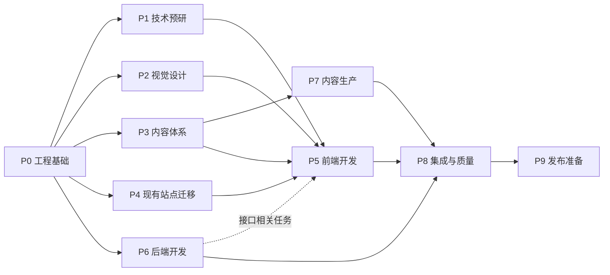

# AI 字典 · AI 开发执行计划

> 版本：v1.0
> 日期：2026-11-27
> 执行者：AI 编码与内容生产 Agent
> 依据文档：[门类规划](ai-knowledge-yellow-pages-category-plan.md)、[知识采集与内容生产规范](ai-dict-knowledge-collection-standard.md)、[平台技术设计](ai-dict-platform-technical-design.md)

本计划面向 AI Agent 执行，不按人日排期。每个任务都写明依赖、必读输入、产出文件和可验证的验收标准，Agent 按依赖关系领取任务，完成后通过验收即视为完成。

---

## 目录

1. [执行规则](#一执行规则)
2. [文档优先级与冲突处理](#二文档优先级与冲突处理)
3. [阶段总览与依赖关系](#三阶段总览与依赖关系)
4. [P0 工程基础](#四p0-工程基础)
5. [P1 技术预研](#五p1-技术预研)
6. [P2 视觉设计](#六p2-视觉设计)
7. [P3 内容体系](#七p3-内容体系)
8. [P4 现有站点迁移](#八p4-现有站点迁移)
9. [P5 前端开发](#九p5-前端开发)
10. [P6 后端开发](#十p6-后端开发)
11. [P7 内容生产](#十一p7-内容生产)
12. [P8 集成与质量](#十二p8-集成与质量)
13. [P9 发布准备](#十三p9-发布准备)
14. [人工确认节点](#十四人工确认节点)
15. [AI 执行风险与防控](#十五ai-执行风险与防控)
16. [不在本计划范围内](#十六不在本计划范围内)

---

## 一、执行规则

### 1.1 任务卡格式

每个任务包含以下字段，Agent 开始任务前必须读完“必读输入”：

| 字段 | 含义 |
|---|---|
| 编号 | `P{阶段}.{序号}`，例如 `P5.03` |
| 依赖 | 必须先完成的任务编号 |
| 必读输入 | 执行前必须阅读的文档章节或文件 |
| 产出 | 必须生成或修改的文件路径 |
| 验收 | 可执行的命令或可逐项核对的检查点，全部通过才算完成 |

### 1.2 通用规则

1. **一个任务一个分支、一个合并请求**。分支命名 `feat/P5.03-copy-button`，提交信息使用 Conventional Commits，描述使用中文。
2. **只修改任务产出范围内的文件**。发现范围外的问题，记录到 `docs/issues.md`，不顺手修改。
3. **不得修改三份依据文档**。发现文档错误或矛盾时，按第二章处理。
4. **验收必须实际执行**。验收中的命令必须在本地或 CI 中真实运行并通过，不能凭推断判定完成。
5. **测试与功能同时交付**。代码类任务必须同时提交对应测试。
6. **不编造信息**。外部 API、框架用法、来源资料必须查阅官方文档或原始资料确认；无法确认时停止并记录。
7. **敏感信息**。代码与内容中不得出现密钥、真实内部域名、IP、人名、客户名；所有外部服务配置通过环境变量读取，并在 `.env.example` 中给出占位。
8. **完成后更新进度**。在 `docs/progress.md` 中将任务标记为完成，记录合并请求链接和验收结果摘要。

### 1.3 完成定义

一个任务视为完成，需同时满足：

- 产出文件全部存在且符合任务要求；
- 验收项全部通过；
- CI 全部通过；
- 合并请求已由另一个 Agent 会话（审核角色）审核通过；
- `docs/progress.md` 已更新。

### 1.4 并行原则

- 同一阶段内无依赖关系的任务可以并行执行；
- 不同阶段之间按第三章依赖图推进；
- 内容生产（P7）在 P3 完成后即可启动，与前后端开发并行。

---

## 二、文档优先级与冲突处理

### 2.1 优先级

| 优先级 | 文档 | 管辖范围 |
|---|---|---|
| 1 | 门类规划 | 门类、知识域、知识点范围；已确认决策 |
| 2 | 知识采集与内容生产规范 | 来源、内容结构、提示词与 Skill 标准、生产流程 |
| 3 | 平台技术设计 | 架构、选型、接口、数据、缓存、各项标准 |
| 4 | 本计划 | 任务拆分与执行顺序 |

### 2.2 冲突处理

1. 低优先级文档与高优先级文档冲突时，以高优先级为准；
2. 同一文档内部矛盾、或文档未覆盖且影响实现的事项，**停止该任务**，在 `docs/questions.md` 中记录：任务编号、问题、涉及章节、可选方案及推荐，等待人工确认；
3. 不影响其他任务的情况下，可以继续执行其他任务。

---

## 三、阶段总览与依赖关系

### 3.1 阶段

| 阶段 | 名称 | 目标 |
|---|---|---|
| P0 | 工程基础 | 单仓库骨架、CI、内容 schema 与校验工具 |
| P1 | 技术预研 | 完成技术设计第二十章中可由 AI 验证的预研事项 |
| P2 | 视觉设计 | 基于现有风格产出设计系统、页面设计稿、门类图标 |
| P3 | 内容体系 | 完整知识点清单与编号、定标类默认标准、来源库、生产工具 |
| P4 | 现有站点迁移 | 445 个素材迁入内容仓库 |
| P5 | 前端开发 | Nuxt 4 前台与管理后台 |
| P6 | 后端开发 | Spring Boot 4 后端全部模块 |
| P7 | 内容生产 | 全部知识点按规范生产完成 |
| P8 | 集成与质量 | 端到端、性能、故障演练、安全检查 |
| P9 | 发布准备 | 部署配置、发布与回滚流水线 |

### 3.2 依赖图

关键路径：**P0 → P3 → P7 → P8 → P9**。内容生产工作量最大，P3 完成后立即启动 P7，与 P5、P6 并行。

P5 中不依赖接口的任务（工程、令牌、内容页面、搜索、复制）可先行；接口相关任务（P5.14–P5.20）在对应的 P6 任务完成后开始，具体依赖见各任务卡。

---

## 四、P0 工程基础

必读输入：技术设计第三章、第四章、第十四章；采集规范第十三章。

| 编号 | 任务 | 依赖 | 产出 | 验收 |
|---|---|---|---|---|
| P0.01 | 初始化单仓库 | — | 按技术设计第四章创建目录结构；根目录 `README.md`、`.editorconfig`、`.gitignore`、`.env.example`；`docs/progress.md`、`docs/issues.md`、`docs/questions.md` | 目录结构与技术设计第四章一致 |
| P0.02 | 内容元数据 schema | P0.01 | `packages/schema/`：知识点、门类、来源、清单四类 schema（字段与采集规范 13.2、13.3 一致），同时导出 TypeScript 类型与 JSON Schema | 单元测试覆盖：合法样例通过、缺必填字段失败、枚举非法值失败 |
| P0.03 | 内容校验工具 | P0.02 | `scripts/validate-content/`：校验 schema、编号唯一与格式、来源引用存在、变量声明与提示词中的 `{{变量}}` 一致、`review_by` 未过期、`eval.score ≥ 4.0`、敏感信息扫描、中文排版检查 | 对 `scripts/validate-content/fixtures/` 中的正反样例逐项给出正确结果；命令 `pnpm validate:content` 可运行 |
| P0.04 | CI 骨架 | P0.03 | CI 配置：内容校验、前端检查占位、后端检查占位、密钥扫描 | 提交一个故意违规的内容样例时 CI 失败，修正后通过 |
| P0.05 | 进度看板 | P0.01 | `docs/progress.md` 按本计划列出全部任务编号与状态 | 任务编号与本计划一致，无遗漏 |

---

## 五、P1 技术预研

必读输入：技术设计第二十章。每个预研任务产出结论报告，写入 `docs/spikes/`，并在 `docs/questions.md` 中提交需人工确认的结论。

| 编号 | 任务 | 依赖 | 产出 | 验收 |
|---|---|---|---|---|
| P1.01 | 中文搜索 | P0.01 | `docs/spikes/search.md`；最小可运行示例：用 200 篇中文样例内容分别测试 Pagefind 与 FlexSearch | 报告包含：20 个典型查询的召回对比、索引体积、查询耗时；给出选型结论 |
| P1.02 | Nuxt Content 静态模式 | P0.01 | `docs/spikes/nuxt-content.md`；用 1200 篇模拟内容进行静态生成 | 报告包含：构建时长；预渲染页面之间客户端导航时的网络请求清单（确认是否加载完整内容数据库）；结论与备选方案取舍 |
| P1.03 | 字体许可与分片 | P0.01 | `docs/spikes/font.md`；HarmonyOS Sans SC 三个字重的 woff2 分片样例 | 报告引用许可证原文条款说明是否允许内部网站自托管；分片后首屏字体下载量实测 ≤ 200 KB |
| P1.04 | 演示隔离 | P0.01 | `docs/spikes/demo-frame.md`；从原站抽取 10 个代表性演示，验证沙箱 iframe、懒加载、暂停、主题同步 | 10 个演示在沙箱中正常运行；主站 Cookie 不可被演示访问 |

---

## 六、P2 视觉设计

### 6.1 设计原则

- **风格唯一依据**：现有「界面素材库」站点与技术设计第六章。不得引入新的配色、字体风格或视觉语言。
- **ui-ux-pro-max 技能的用法**：
  - 执行设计任务前阅读技能文件 `~/.claude/plugins/cache/ui-ux-pro-max-skill/ui-ux-pro-max/2.0.1/.claude/skills/ui-ux-pro-max/SKILL.md`；
  - 使用技能脚本的领域检索获取规则：`ux`（交互、无障碍、加载、动效）、`landing`（首页结构）、`icons`（图标）、`chart`（管理后台图表）；
  - **不使用 `--design-system` 生成新风格**，设计系统内容由现有风格提炼；
  - 沿用技能的“总规范 + 页面规范”文件组织方式：`design-system/MASTER.md` 为总规范，`design-system/pages/{页面}.md` 为页面规范；
  - 每个设计产出交付前，按技能“Quick Reference”第 1–3 类（无障碍、交互、性能）逐项自检。
- **设计稿形式**：每个页面产出“页面规范文档 + 可交互 HTML 原型”，原型只使用设计令牌，并提供浅色、深色两套截图。

### 6.2 任务

| 编号 | 任务 | 依赖 | 产出 | 验收 |
|---|---|---|---|---|
| P2.01 | 风格提炼 | P0.01 | `design-system/MASTER.md`：颜色、圆角、间距、字号、字重、阴影、玻璃、动效令牌（与技术设计 6.2、6.3 一致）；组件视觉规则；原站页面截图对照 | 令牌数值与原站 CSS 一致（附提取脚本与比对结果）；文档中不含任何原站之外的新颜色 |
| P2.02 | 令牌文件 | P2.01 | `apps/web/app/assets/tokens/tokens.css`（浅色、深色、跟随系统三种情况）、`tokens.ts` | 浅色与深色下主文字与背景对比度 ≥ 4.5:1，次要文字 ≥ 3:1（附自动计算结果） |
| P2.03 | 基础组件设计 | P2.02 | `design-system/pages/components.md` + `design/prototypes/components.html`：按钮、胶囊标签、搜索框、卡片、弹窗、标签页、筛选栏、三态视图、提示条 | 每个组件包含默认、悬停、按下、聚焦、禁用状态；可点击区域 ≥ 44×44px；焦点环可见 |
| P2.04 | 门类图标 | P2.01 | `design/icons/category/{门类编码}.svg` 共 22 个；`design-system/pages/icons.md` 说明每个图标的含义与隐喻 | 全部为 24×24 画布、线条风格、统一线宽、圆角端点、使用 `currentColor`；脚本校验 `viewBox`、线宽、无填充色；浅色与深色下截图清晰可辨 |
| P2.05 | 首页设计 | P2.03、P2.04 | `design-system/pages/home.md` + `design/prototypes/home.html` | 包含首屏超大标题与渐变光球、全局搜索、22 个门类入口、6 个场景入口、本周上新、热门榜；375px、768px、1440px 三档宽度截图无横向滚动 |
| P2.06 | 门类页与知识域页设计 | P2.03 | `design-system/pages/category.md`、`domain.md` + 原型 | 包含面包屑、知识域列表、知识卡片列表、筛选栏；空状态设计 |
| P2.07 | 知识卡片设计 | P2.03 | `design-system/pages/knowledge-card.md` + 原型 | 编号使用等宽字体；标题过长时换行策略明确；悬停弹簧上浮动效；在减少动效设置下无位移 |
| P2.08 | 知识点详情页设计 | P2.07 | `design-system/pages/knowledge-detail.md` + 原型（文字类知识点、UX 素材类知识点两种） | 包含形态标签页、提示词块（变量高亮）、效果展示、使用说明、依据来源、相关知识点、收藏与反馈；UX 类包含演示区 |
| P2.09 | 变量填写弹窗设计 | P2.03 | `design-system/pages/variable-fill.md` + 原型 | 字段标签可见、必填标识、错误提示位于字段下方、实时预览、复制成功反馈 |
| P2.10 | 搜索面板与结果页设计 | P2.03 | `design-system/pages/search.md` + 原型 | 键盘可完整操作；无结果状态引导到需求墙 |
| P2.11 | 需求墙与“我的”设计 | P2.03 | `design-system/pages/requests.md`、`me.md` + 原型 | 需求状态有文字与图标双重表达，不只依赖颜色；投票即时反馈 |
| P2.12 | 管理后台设计 | P2.02 | `design-system/pages/admin.md` + 原型：Element Plus 主题变量映射、需求处理、反馈列表、统计看板、用户管理 | Element Plus 主色、圆角、字体映射到设计令牌；图表遵循技能 `chart` 领域规则（图例、提示、无障碍配色） |
| P2.13 | 设计自检 | P2.05–P2.12 | `design-system/review.md`：按技能 Quick Reference 第 1–7 类逐项检查结果 | 无未处理的第 1–3 类问题 |

---

## 七、P3 内容体系

必读输入：门类规划全文；采集规范全文。

### 7.1 任务

| 编号 | 任务 | 依赖 | 产出 | 验收 |
|---|---|---|---|---|
| P3.01 | 门类定义 | P0.02 | `content/categories/{门类编码}.yml` 共 22 个：编码、名称、大类、简介、知识域列表、图标引用 | 门类与知识域数量分别为 22 与 157，与门类规划第五章一致 |
| P3.02 | 知识点清单与编号 | P3.01 | `content/catalog/{门类编码}.yml`：每个知识点的编号、标题、知识域、知识属性（行业通用 / 公司定标）、用法、形态、使用环境、技术栈、拟用来源方向 | 见 7.2 分配规则；校验脚本确认：门类规划中列出的每个知识点都在清单中、编号唯一且连续、★ 知识点全部标为公司定标 |
| P3.03 | 来源库初始化 | P3.01 | `content/sources/SRC-xxxx.yml`：采集规范第四章列出的全部首选来源 | 每个来源字段完整；链接可访问（脚本检查 HTTP 状态）；来源等级与采集规范 3.1 一致 |
| P3.04 | 定标类默认标准 | P3.02、P3.03 | `content/standards/{门类编码}/{编号}.md`：约 215 份，每份包含至少 3 家公开做法对比表、默认标准、取值依据、来源编号 | 见 7.3 |
| P3.05 | 知识点起草模板 | P3.02 | `scripts/content-templates/draft-prompt.md`：交给 AI 起草知识点的统一提示词；`templates/knowledge/` 目录模板 | 用模板起草 3 个不同门类的样例，均通过 `pnpm validate:content` |
| P3.06 | 效果验证工具 | P0.02 | `scripts/eval/`：读取知识点 `samples/` 中的样例，调用至少 2 个不同厂商的模型接口运行，保存输出，生成评分表模板 | 模型接口地址与密钥通过环境变量配置；对 1 个样例知识点完整跑通并生成结果文件 |
| P3.07 | 审核清单 | P3.05 | `scripts/content-templates/review-checklist.md`：审核角色逐项核对的清单（来源一致性、结构、排版、脱敏、效果验证） | 清单覆盖采集规范第十章 10.2 的全部审核要求 |
| P3.08 | 校准批次 | P3.04、P3.05、P3.06、P3.07 | 按 7.4 选取 12 个知识点完整生产，产出 `docs/calibration.md`：问题汇总与模板修订 | 12 个知识点全部通过校验与效果验证；模板根据问题完成修订 |

### 7.2 清单分配规则（P3.02）

| 字段 | 分配规则 |
|---|---|
| 编号 | 按门类规划中知识域出现顺序、知识点出现顺序连续编号；UX 门类从 `UX-446` 开始（`UX-001` 至 `UX-445` 保留给迁移素材） |
| 知识属性 | 门类规划中带 ★ 的为“公司定标”，其余为“行业通用” |
| 用法 | 规范、标准类（如编码规范、接口规范）：生成 + 审查 + 讲解；方法、模式类（如设计模式、分析方法）：生成 + 讲解；检查清单类（如审查清单、走查清单）：审查；概念、原理类：讲解 |
| 形态 | 含“生成”用法的必须提供标准版；被 AI 编程工具高频使用的规范类提供 Skill；所有知识点提供快捷版 |
| 使用环境 | 需要读写项目文件的为“AI 编程工具”；提供 Skill 的增加“支持 Skill 的工具”；其余为“任意 AI 对话工具” |
| 技术栈 | 仅研发类门类中与具体语言相关的知识点填写 |

清单生成后，Agent 需对每个门类输出一份分配摘要（各用法、形态数量统计），供人工确认节点使用。

### 7.3 默认标准制定要求（P3.04）

- 每份标准至少对比 3 家公开做法，来源等级符合采集规范 3.2；
- 给出默认标准与具体数值，每个数值写明取值依据；
- 不得出现“视情况而定”等无法执行的表述；确需区分场景时，按场景分别给出数值；
- 按门类分批提交，每批一个合并请求；
- 审核角色逐份核对对比表中的每个来源确实支持表中所列做法。

### 7.4 校准批次选取（P3.08）

覆盖不同内容类型，用于发现模板问题：

| 类型 | 选取 |
|---|---|
| 代码生成 + Skill | 后端编码规范 1 个、设计模式 1 个、前端组件设计 1 个 |
| 公司定标 | 后端性能标准 1 个、信息安全数据分级 1 个 |
| 文档与 PPT | EXP 的 PPT 故事线 1 个、技术文档类型 1 个 |
| 绘图 | EXP 的架构图 1 个 |
| 职能 | 财务报表解读 1 个、法务合同审查 1 个 |
| 业务 | 市场文案写作 1 个 |
| 通用 | AI 通用能力提示词基础 1 个 |

---

## 八、P4 现有站点迁移

必读输入：技术设计第七章。原站 HTML 由人工提供并放置于 `scripts/migrate-legacy/input/legacy.html`。

| 编号 | 任务 | 依赖 | 产出 | 验收 |
|---|---|---|---|---|
| P4.01 | 素材数据解析 | P0.02 | `scripts/migrate-legacy/extract.ts`：解析原站内嵌数据，输出中间 JSON | 解析出 445 条，字段包含编号、分类、标题、摘要、HTML、JS、提示词 |
| P4.02 | 分类映射 | P4.01、P3.01 | `scripts/migrate-legacy/category-map.ts`：29 个韩文分类到中文与知识域的映射（与技术设计 7.2 一致） | 445 条全部映射成功，无未映射分类 |
| P4.03 | 生成知识点 | P4.02 | `content/knowledge/UX/UX-001-*` 至 `UX-445-*`：元数据 + 提示词 | 445 个目录全部通过 `pnpm validate:content`（迁移素材的效果验证字段按迁移规则标记为待补） |
| P4.04 | 拆分演示 | P4.01、P1.04 | `content/demos/UX/UX-001.html` 至 `UX-445.html`，引用共用令牌样式 | Playwright 批量打开 445 个演示页：无脚本报错、首屏非空白 |
| P4.05 | 清理与跳转 | P4.03 | 韩文注释清理结果；旧编号与旧锚点到新地址的跳转映射表 `content/redirects.json` | 产出中不含韩文字符（脚本检查）；445 条跳转映射完整 |
| P4.06 | 迁移报告 | P4.03–P4.05 | `docs/migration-report.md` | 包含数量核对、问题演示清单与处理结果 |

---

## 九、P5 前端开发

必读输入：技术设计第五章、第六章、第十一章 11.2–11.4、第十二章 12.2、第十四章 14.2、第十五章 15.1；`design-system/` 全部文件。

| 编号 | 任务 | 依赖 | 产出 | 验收 |
|---|---|---|---|---|
| P5.01 | Nuxt 4 工程初始化 | P0.01 | `apps/web/`：Nuxt 4、TypeScript 严格模式、ESLint、Prettier、Stylelint、Vitest、Playwright 配置 | `pnpm lint`、`pnpm typecheck`、`pnpm test` 通过；Stylelint 拦截写死颜色值 |
| P5.02 | 令牌、字体与主题 | P5.01、P2.02、P1.03 | 令牌引入；字体分片与 `@font-face`；`@nuxtjs/color-mode` 配置存储键 `ux-gallery-theme` | 首屏无主题闪烁；切换主题后刷新保持；字体加载前文字可见 |
| P5.03 | 内容集合 | P5.01、P0.02、P1.02 | `content.config.ts`：知识点、门类、来源集合，复用 `packages/schema` | 不合规内容导致构建失败；合规样例正常生成页面 |
| P5.04 | 布局与顶栏 | P5.02、P2.03 | `layouts/default.vue`、`AppHeader`、`ThemeToggle`、页脚、跳到主内容链接 | 顶栏玻璃效果与吸顶；键盘可达；路由切换后焦点移到主内容 |
| P5.05 | 基础组件 | P5.02、P2.03 | 按钮、胶囊标签、卡片、弹窗、标签页、`StateView`、提示条 | 组件单元测试；与 `design/prototypes/components.html` 截图对比一致 |
| P5.06 | 首页 | P5.04、P5.05、P2.05 | `pages/index.vue`、`CategoryGrid` | 与首页原型一致；LCP ≤ 2.0 秒（Lighthouse） |
| P5.07 | 门类页与知识域页 | P5.03、P5.05、P2.06 | `pages/c/[category]/index.vue`、`pages/c/[category]/[domain].vue`、`FilterBar` | 筛选条件同步地址栏；空状态正确显示 |
| P5.08 | 知识卡片 | P5.05、P2.07 | `KnowledgeCard` | 与原型一致；减少动效设置下无位移动画 |
| P5.09 | 知识点详情页 | P5.07、P5.08、P2.08 | `pages/k/[id].vue`、`FormTabs`、`PromptBlock`、`SourceList`、`SkillDownload` | 只显示知识点实际提供的形态；变量高亮；LCP ≤ 1.5 秒 |
| P5.10 | 复制与变量填写 | P5.09、P2.09 | `useCopy`、`VariableFillDialog` | 端到端测试：必填未填时定位到字段；填写后复制内容与预览一致；剪贴板不可用时降级 |
| P5.11 | 演示容器 | P5.09、P1.04 | `DemoFrame` | 沙箱属性为 `allow-scripts`；进入视口加载、离开暂停；主题同步；同屏运行不超过 6 个 |
| P5.12 | 场景页 | P5.07 | `pages/s/[scene].vue` | 6 个场景的内容引用与门类规划第十一章一致 |
| P5.13 | 搜索 | P5.03、P1.01、P2.10 | `useSearch` 适配层、`GlobalSearch`、`pages/search.vue`、索引生成脚本 `scripts/build-index/` | 快捷键 `/` 唤起；输入完整编号直接跳转；查询 ≤ 100 毫秒；无结果时引导到需求墙 |
| P5.14 | 接口层 | P5.01、P6.02 | `api/`：openapi-typescript 生成类型、请求封装（超时、重试、登录错误处理）、VO 适配函数 | CI 校验生成类型与后端文档一致 |
| P5.15 | 登录 | P5.14、P6.06 | `useAuth`、`pages/login/callback.vue` | 端到端测试（使用飞书模拟服务）：飞书内免登与浏览器授权两条路径均成功；登录后返回原页面 |
| P5.16 | 收藏与反馈 | P5.15、P6.07、P6.08 | `useFavorite`、`FavoriteButton`、`FeedbackPanel` | 乐观更新与失败回滚测试；本地收藏集合与后端同步 |
| P5.17 | 需求墙与“我的” | P5.15、P6.09、P2.11 | `pages/requests.vue`、`pages/me/**`、`RequestBoard` | 提交、投票、取消投票端到端测试；状态展示不只依赖颜色 |
| P5.18 | 埋点 | P5.14、P6.10 | `useTracker` | 批量发送（10 秒或页面隐藏）；单批 ≤ 50 条；未登录也能上报 |
| P5.19 | 版本检测与降级 | P5.14 | `useVersionCheck`、`useBackendHealth`、`UpdateToast` | 模拟新版本出现提示；模拟后端不可用时收藏、反馈、需求墙入口隐藏，内容浏览与复制正常 |
| P5.20 | 管理后台 | P5.15、P6.13、P2.12 | `pages/admin/**`：需求处理、反馈列表、统计看板、用户管理 | 非管理员访问被拒绝；Element Plus 主题与令牌一致 |
| P5.21 | Skill 打包与静态产物 | P5.03 | `scripts/pack-skills/`、`version.json` 与知识索引 JSON 生成 | 每个含 Skill 的知识点生成带哈希的压缩包；知识索引包含全部已发布知识点 |
| P5.22 | 缓存头与静态配置 | P5.21 | `apps/web/deploy/nginx.conf` 模板：按技术设计 11.2、11.3 配置缓存头、压缩、旧版本资源保留 | 配置测试：各类资源返回的 `Cache-Control` 与技术设计 11.2 一致 |

---

## 十、P6 后端开发

必读输入：技术设计第八章至第十二章、第十四章 14.3、第十五章 15.2、第十六章、第十七章；《阿里巴巴 Java 开发手册》（黄山版）。

| 编号 | 任务 | 依赖 | 产出 | 验收 |
|---|---|---|---|---|
| P6.01 | 工程初始化 | P0.01 | `apps/server/`：Java 25、Spring Boot 4、Maven、MyBatis-Plus、Flyway、Redisson、Caffeine、springdoc；Spotless、P3C、SpotBugs 配置；分层包结构 | `mvn verify` 通过；P3C 无严重问题 |
| P6.02 | 通用组件 | P6.01 | 统一返回结构、错误码枚举（技术设计 8.5）、全局异常处理、traceId 过滤器、JSON 日志与脱敏、Bean Validation 配置、OpenAPI 配置 | 单元测试：异常转换为正确错误码；日志中会话 ID 与 Cookie 被脱敏 |
| P6.03 | 数据库脚本 | P6.01 | Flyway 脚本：技术设计 10.2 全部 9 张表及索引；`dict_event` 月分区 | Testcontainers 中执行迁移成功；表名、字段、索引命名符合手册规约（附校验脚本） |
| P6.04 | Redis 与多级缓存 | P6.01 | Redisson 配置（哨兵与集群两种模式通过配置切换）；`MultiLevelCacheTemplate`；键命名工具；发布订阅本地缓存失效广播 | 测试：多级读取与回填；过期时间随机偏移；广播后所有实例本地缓存失效 |
| P6.05 | 横切注解 | P6.02、P6.04 | `@RateLimit`、`@Idempotent`、`@AuditLog`、`@RequireAdmin` 及切面 | 测试：超限返回 `A0501`；重复提交返回 `A0506`；非管理员返回 `A0301`；Redis 不可用时限流放行并记录告警日志 |
| P6.06 | 飞书登录与会话 | P6.03、P6.04 | `FeishuManager`（接口 + 实现，门面 + 适配器）；飞书模拟服务（测试用）；auth 模块：授权地址、登录、退出；会话存储与滑动续期；用户会话索引；会话本地缓存 | 测试（使用模拟服务）：两种登录路径；state 一次性校验；退出后会话立即失效；禁用用户清除全部会话；Cookie 属性符合技术设计 9.3 |
| P6.07 | 收藏模块 | P6.06 | favorite 模块全部接口 | 测试：越权访问他人数据被拒绝；编号不存在返回参数错误（经本地知识索引校验，不访问数据库） |
| P6.08 | 反馈模块 | P6.06 | feedback 模块全部接口 | 测试：同一用户对同一知识点只保留最新评价 |
| P6.09 | 需求模块 | P6.06、P6.05 | request 模块：提交、列表、投票、取消投票；`RequestStatusEnum` 状态机；状态变更事件 | 测试：非法状态转换被拒绝；重复投票被唯一约束拦截；不予收录必须填写原因 |
| P6.10 | 埋点模块 | P6.04 | event 模块：批量接收；按事件类型的策略处理器；Redis 计数 | 测试：单批超过 50 条被拒绝；Redis 不可用时降级同步写库 |
| P6.11 | 统计与定时任务 | P6.10 | `AbstractScheduledJob`；计数回写、统计汇总、热门榜重建、分区维护任务；热门榜逻辑过期与互斥重建 | 测试：多实例下任务只执行一次；热门榜过期时返回旧值并只触发一次重建 |
| P6.12 | 通知模块 | P6.06、P6.09 | notify 模块：通知渠道策略、`FeishuCardBuilder`、需求状态变更私信、每周上新推送 | 测试（模拟服务）：发送失败重试 3 次后记录日志且不影响主流程 |
| P6.13 | 管理接口 | P6.05、P6.09、P6.11 | admin 模块全部接口；审计日志写入 | 测试：所有管理操作产生审计日志 |
| P6.14 | 内容同步接口 | P6.04、P6.03 | `/api/internal/content/published`：内部令牌校验、更新知识索引表、刷新本地索引、广播、清理统计缓存 | 测试：无令牌或外网来源被拒绝；同步后所有实例知识索引一致 |
| P6.15 | 健康检查与监控 | P6.01 | 存活与就绪探针；Micrometer 指标（接口耗时分位、缓存命中率、飞书调用失败率、任务执行结果） | 就绪探针在 MySQL 或 Redis 不可用时返回不就绪；指标端点输出上述指标 |
| P6.16 | 覆盖率与规约门禁 | P6.07–P6.14 | CI 中 Service 层覆盖率门槛、P3C、SpotBugs、Spotless | Service 层行覆盖率 ≥ 70%；静态检查无严重问题 |

---

## 十一、P7 内容生产

必读输入：采集规范全文；`docs/calibration.md`；`scripts/content-templates/` 全部文件。

### 11.1 角色

内容生产由两个相互独立的 Agent 会话完成：

| 角色 | 职责 | 限制 |
|---|---|---|
| 编写 Agent | 按清单生产知识点：来源采集、起草、来源核对、样例编写、效果验证 | 不得审核自己的产出 |
| 审核 Agent | 按审核清单逐项核对，特别是逐条核对【背景知识】与来源原文一致 | 不得修改内容，只能通过或打回并写明原因 |

### 11.2 单个知识点的生产流程

| 步骤 | 执行者 | 动作 | 产出 |
|---|---|---|---|
| 1 | 编写 | 读取清单条目与（定标类）默认标准 | — |
| 2 | 编写 | 采集来源：打开原始资料，摘录支撑要点，新增来源时登记来源库 | `sources` 引用 |
| 3 | 编写 | 用起草模板生成全部形态 | `index.md`、`prompt-quick.md`、`prompt-standard.md`、`skill/` |
| 4 | 编写 | 逐条核对【背景知识】与来源原文，删除无来源支撑的内容 | 核对记录 |
| 5 | 编写 | 编写 3 组样例（典型、边界、信息缺失） | `samples/` |
| 6 | 编写 | 运行效果验证工具，按采集规范第十一章评分 | `samples/` 中的输出与评分 |
| 7 | 编写 | 运行 `pnpm validate:content` | 校验通过 |
| 8 | 审核 | 按审核清单逐项核对 | 通过或打回 |

### 11.3 批次与顺序

- 每个批次为一个知识域，一个合并请求；
- 定标类知识点必须在对应默认标准（P3.04）合并后才能开始；
- 门类生产顺序如下，同一组内的门类可并行：

| 组 | 门类 | 原因 |
|---|---|---|
| 第一组 | GEN、EXP、SEC | 所有人都会用到；AI 使用红线需最先可用 |
| 第二组 | BE、FE、QA、OPS、ARCH、AIE | 研发类公开来源最丰富，Skill 需求最集中 |
| 第三组 | DATA、MO、PD、UX（新增知识点与迁移素材补齐） | — |
| 第四组 | FIN、HR、LEG、ADM | 法规类来源需记录版本与生效日期 |
| 第五组 | MKT、SAL、OPR、CS、MGT | — |

### 11.4 抽检

- 每个门类完成后，由一个新的审核 Agent 会话随机抽取 10% 的知识点进行深度复核：重新核对全部来源、重新运行效果验证；
- 抽检错误率超过 5% 时，该门类全部返工；
- 抽检结果写入 `docs/content-audit/{门类编码}.md`。

### 11.5 迁移素材补齐

445 个 UX 迁移素材按同样流程补齐：元数据完善、变量声明、来源（以原站与设计系统为来源）、效果验证。

### 11.6 完成标准

| 检查项 | 标准 |
|---|---|
| 数量 | 清单中全部知识点状态为 `published` |
| 校验 | `pnpm validate:content` 全部通过 |
| 效果验证 | 全部知识点平均分 ≥ 4.0 |
| 抽检 | 22 个门类抽检报告齐全，错误率均 ≤ 5% |

---

## 十二、P8 集成与质量

必读输入：技术设计第十五章至第十八章。

| 编号 | 任务 | 依赖 | 产出 | 验收 |
|---|---|---|---|---|
| P8.01 | 全量构建 | P5 全部、P7 全部 | 全量内容静态生成产物 | 构建时长 ≤ 10 分钟；无构建错误 |
| P8.02 | 端到端测试 | P8.01、P6 全部 | Playwright 套件：搜索、复制、变量填写、登录、收藏、反馈、提需求、投票、管理后台、主题切换 | 全部通过 |
| P8.03 | 性能测试 | P8.01 | `docs/test-reports/performance.md`：Lighthouse 与接口压测结果 | 全部指标满足技术设计第十五章 |
| P8.04 | 无障碍检查 | P8.01 | axe 检查全部页面类型；`docs/test-reports/a11y.md` | 无严重与重要级别问题 |
| P8.05 | 故障演练 | P8.02 | `docs/test-reports/chaos.md`：在测试环境模拟后端停机、Redis 不可用、飞书不可用 | 行为与技术设计 2.3、11.8、第十六章一致 |
| P8.06 | 安全检查 | P8.02 | `docs/test-reports/security.md`：越权、跨站脚本、跨站请求伪造、限流、内部接口访问控制、依赖漏洞扫描、密钥扫描 | 无高危问题 |
| P8.07 | 内容总检 | P7 全部 | `docs/test-reports/content.md`：数量、校验、效果验证分数分布、来源链接可访问性、复审日期 | 满足 11.6；失效来源链接为 0 |
| P8.08 | 视觉走查 | P8.01 | `docs/test-reports/visual.md`：全部页面在浅色、深色及 375px、768px、1440px 下与设计稿对比截图 | 无与设计系统不一致的问题；按 ui-ux-pro-max 技能 Quick Reference 第 1–7 类自检通过 |

---

## 十三、P9 发布准备

不包含环境开通与飞书应用申请（见第十六章）。所有配置以模板形式交付，环境相关值通过变量注入。

| 编号 | 任务 | 依赖 | 产出 | 验收 |
|---|---|---|---|---|
| P9.01 | 后端部署配置 | P6 全部 | `apps/server/deploy/`：Deployment（2 副本、反亲和、探针、优雅停机）、HPA（最小 2、最大 4）、ConfigMap 与 Secret 模板 | 配置校验通过；所有环境相关值为变量 |
| P9.02 | 前端发布脚本 | P5.22 | 原子发布、保留 10 个版本、保留最近 3 个版本静态资源、回滚脚本 | 在测试环境演示发布与回滚，回滚 ≤ 5 分钟 |
| P9.03 | 发布流水线 | P9.01、P9.02 | CI 发布阶段：内容发布后调用内容同步接口 | 测试环境完整走通一次“内容合并 → 构建 → 发布 → 后端同步” |
| P9.04 | 监控与告警配置 | P6.15 | 监控面板与告警规则模板（技术设计第十八章） | 告警规则覆盖第十八章全部条目 |
| P9.05 | 运维手册 | P9.01–P9.04 | `docs/runbook.md`：发布、回滚、常见故障处理、配置项说明 | 覆盖技术设计第十六章故障分级中的全部场景 |

---

## 十四、人工确认节点

以下节点完成后，Agent 暂停相关后续任务，等待人工确认：

| 节点 | 触发时机 | 需确认的内容 | 阻塞的后续任务 |
|---|---|---|---|
| C1 预研结论 | P1 全部完成 | 搜索选型、内容管理方案、字体方案 | P5.02、P5.03、P5.13 |
| C2 设计系统 | P2.01–P2.04 完成 | 风格还原度、门类图标 | P2.05 及之后的设计任务 |
| C3 页面设计 | P2.13 完成 | 全部页面设计稿 | P5.06 及之后的页面任务 |
| C4 知识点清单 | P3.02 完成 | 各门类的分配摘要与完整清单 | P3.04、P7 |
| C5 校准批次 | P3.08 完成 | 12 个样例知识点的质量、模板修订 | P7 |
| C6 默认标准 | P3.04 每个门类批次完成 | 该门类的定标类默认标准 | 该门类的定标类知识点生产 |
| C7 上线前验收 | P8 全部完成 | 全部测试报告 | P9 发布 |

---

## 十五、AI 执行风险与防控

| 风险 | 表现 | 防控措施 |
|---|---|---|
| 编造来源 | 引用不存在的资料或错误归属观点 | 来源链接必须可访问（脚本检查）；审核 Agent 逐条核对原文；抽检复核 |
| 编造 API 用法 | 使用不存在的框架接口 | 必须查阅官方文档；以编译、测试通过为准 |
| 风格漂移 | 页面视觉偏离现有风格 | Stylelint 禁止写死颜色；P8.08 截图对比；设计系统为唯一依据 |
| 内容风格不一致 | 不同批次的提示词写法差异大 | 统一起草模板；校准批次修订模板；校验脚本检查结构 |
| 上下文过长 | 单次任务资料过多导致遗漏 | 任务按知识域拆批；必读输入只列相关章节 |
| 自我审核 | 编写与审核由同一会话完成 | 编写与审核必须为不同会话；审核 Agent 只能通过或打回 |
| 范围蔓延 | 顺手修改无关文件 | 只修改任务产出范围；范围外问题记录到 `docs/issues.md` |
| 模型访问受限 | 效果验证无法调用 2 个不同厂商的模型 | 效果验证工具通过环境变量配置模型接口；无法满足时停止并在 `docs/questions.md` 记录 |

---

## 十六、不在本计划范围内

以下事项由人工完成，不安排 AI 执行：

| 事项 | 说明 |
|---|---|
| 环境开通 | K8s 命名空间、域名、证书、MySQL 与 Redis 实例、CI 平台配置 |
| 飞书应用 | 创建企业自建应用、申请权限、配置回调地址白名单、添加到工作台 |
| 密钥与配置注入 | 飞书应用密钥、数据库与 Redis 连接信息、模型接口密钥、内部令牌 |
| 原站文件提供 | 将原站 HTML 放置到 `scripts/migrate-legacy/input/legacy.html` |
| 人工确认 | 第十四章全部确认节点 |
| 生产发布操作 | 生产环境的最终发布审批与执行 |
