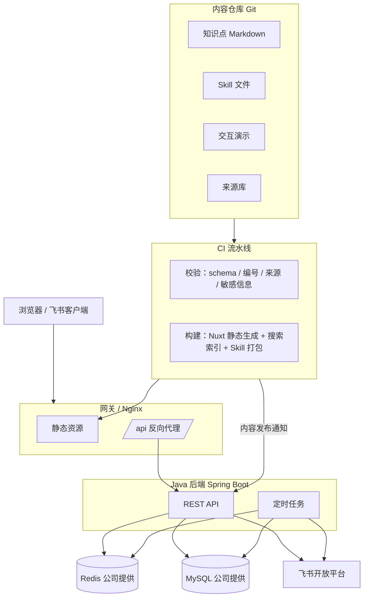
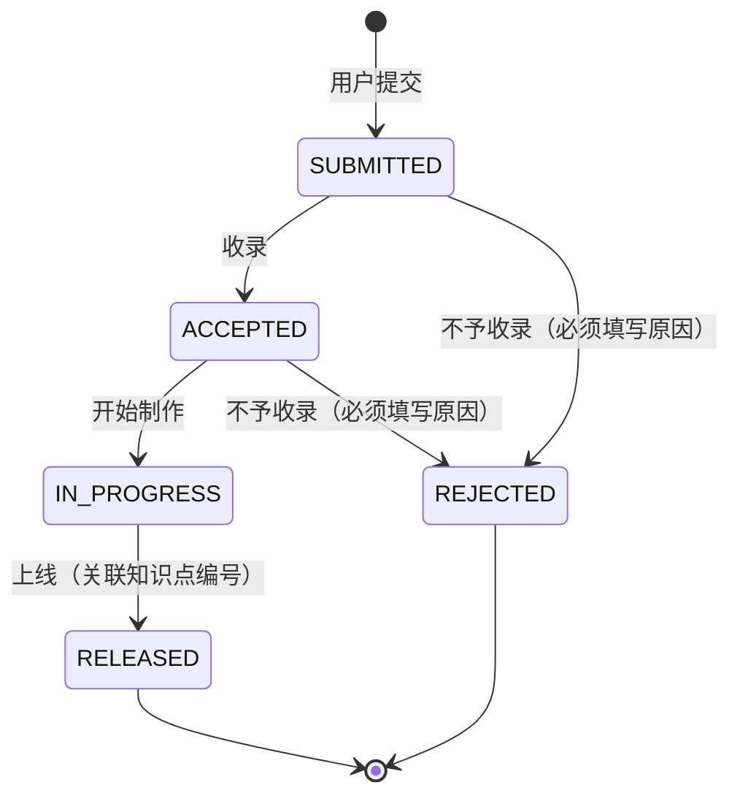

# AI 字典 · 平台技术设计

> 版本：v1.0
> 日期：2026-11-27
> 适用对象：AI 字典开发团队（前端、后端、运维）
> 关联文档：[门类规划](ai-knowledge-yellow-pages-category-plan.md)、[知识采集与内容生产规范](ai-dict-knowledge-collection-standard.md)

---

## 目录

1. [设计目标与约束](#一设计目标与约束)
2. [总体架构](#二总体架构)
3. [技术选型与版本基线](#三技术选型与版本基线)
4. [工程结构](#四工程结构)
5. [前端设计](#五前端设计)
6. [视觉风格与设计令牌](#六视觉风格与设计令牌)
7. [现有站点迁移](#七现有站点迁移)
8. [后端设计](#八后端设计)
9. [飞书登录与会话](#九飞书登录与会话)
10. [数据库设计](#十数据库设计)
11. [缓存设计](#十一缓存设计)
12. [设计模式应用](#十二设计模式应用)
13. [构建、发布与内容同步](#十三构建发布与内容同步)
14. [技术标准](#十四技术标准)
15. [性能标准](#十五性能标准)
16. [稳定性标准](#十六稳定性标准)
17. [安全设计](#十七安全设计)
18. [监控与告警](#十八监控与告警)
19. [容量估算](#十九容量估算)
20. [预研事项](#二十预研事项)

---

## 一、设计目标与约束

### 1.1 设计目标

| 目标 | 说明 |
|---|---|
| 快 | 知识内容页静态生成，打开即是成品页面 |
| 稳 | 浏览、搜索、复制、下载不依赖后端；任何一层故障都尽量不影响查看内容 |
| 新 | 内容发布后用户立即看到新版本，不出现长期旧缓存 |
| 好用 | 变量填写复制、一键下载 Skill、全局搜索、深浅色主题 |
| 好维护 | 内容即代码，用 Git 管理；前后端接口契约自动生成；规范由工具自动检查 |

### 1.2 约束条件

| 约束 | 内容 |
|---|---|
| 用户规模 | 按 2000 人设计 |
| 登录 | 飞书，通过飞书自建应用（机器人）获取用户信息 |
| 后端语言 | Java |
| 基础设施 | K8s、MySQL、Redis 由公司提供，本项目直接使用 |
| 内容生产 | 仅项目团队生产，通过 Git 提交 |
| 视觉风格 | 完整沿用现有「界面素材库」风格 |
| 代码规范 | 后端执行《阿里巴巴 Java 开发手册》（黄山版） |

---

## 二、总体架构

### 2.1 架构图



### 2.2 职责划分

| 部分 | 职责 | 不负责 |
|---|---|---|
| 内容仓库 | 存放全部知识点、Skill、演示、来源 | — |
| 前端静态站 | 门类、知识域、知识点、场景页面的展示；搜索；复制；下载 | 不存储任何用户数据 |
| Java 后端 | 登录与会话、收藏、反馈、需求墙、统计、飞书通知、管理后台接口 | **不存储知识内容**，只通过编号关联 |
| MySQL | 用户、收藏、反馈、需求、统计数据 | — |
| Redis | 会话、飞书凭证、热点数据缓存、计数、限流 | — |

### 2.3 降级原则

**读内容的链路零后端依赖。** 后端、Redis、MySQL 任一故障时：

| 功能 | 是否受影响 |
|---|---|
| 浏览门类、知识点、演示 | 不受影响 |
| 全局搜索 | 不受影响（本地索引） |
| 复制提示词、下载 Skill | 不受影响 |
| 收藏、反馈、需求墙、热门榜、登录 | 受影响，前端自动隐藏入口或展示缓存数据 |

---

## 三、技术选型与版本基线

### 3.1 前端

| 项目 | 选型 | 版本基线 |
|---|---|---|
| 框架 | Nuxt | 4.x（当前稳定版；Nuxt 3 已于 2026-07-31 停止维护） |
| 视图层 | Vue | 3.x |
| 语言 | TypeScript | 5.x，严格模式 |
| 内容管理 | Nuxt Content | 与 Nuxt 4 配套的最新稳定版 |
| 状态管理 | Pinia | 最新稳定版 |
| 主题切换 | @nuxtjs/color-mode | 最新稳定版 |
| 管理后台组件库 | Element Plus | 最新稳定版 |
| 搜索 | Pagefind（首选）/ FlexSearch（备选） | 见预研事项 |
| 测试 | Vitest、Playwright、axe-core | 最新稳定版 |
| 运行环境 | Node.js | 当前 LTS 版本 |

### 3.2 后端

| 项目 | 选型 | 版本基线 |
|---|---|---|
| 语言 | Java | 25（LTS）；公司基础镜像仅提供 21 时可使用 21（LTS） |
| 框架 | Spring Boot | 4.x（Spring Boot 3.5 开源支持已于 2026-06-30 结束） |
| 数据访问 | MyBatis-Plus | 3.5.18 及以上，使用 `mybatis-plus-spring-boot4-starter` |
| 数据库变更 | Flyway | 与 Spring Boot 配套版本 |
| Redis 客户端 | Redisson | 支持 Spring Boot 4 的最新稳定版 |
| 本地缓存 | Caffeine | 最新稳定版 |
| 接口文档 | springdoc-openapi | 支持 Spring Boot 4 的版本 |
| 监控 | Micrometer + Prometheus | 与 Spring Boot 配套 |
| 飞书 SDK | 飞书开放平台官方 Java SDK | 最新稳定版 |
| 构建 | Maven | 3.9 及以上 |
| 测试 | JUnit 5、Testcontainers、Mockito | 最新稳定版 |
| 静态检查 | P3C（阿里规约）、SpotBugs、Spotless | 最新稳定版 |

**版本策略**：开工时锁定上述框架的最新稳定小版本；每季度评估一次升级；框架停止维护前至少 3 个月完成升级。

---

## 四、工程结构

采用单仓库，内容、前端、后端统一版本管理。

```
ai-dict/
├── apps/
│   ├── web/                        # 前端 Nuxt 4
│   │   ├── app/
│   │   │   ├── pages/              # 路由页面
│   │   │   ├── components/         # 组件
│   │   │   ├── composables/        # 组合式函数
│   │   │   ├── stores/             # Pinia
│   │   │   ├── api/                # 接口封装 + 自动生成的类型
│   │   │   ├── assets/
│   │   │   │   ├── tokens/         # 设计令牌
│   │   │   │   └── fonts/          # HarmonyOS Sans SC 分片
│   │   │   └── layouts/
│   │   ├── public/demos/           # 交互演示（构建时从 content 复制）
│   │   ├── content.config.ts       # 内容集合与 schema
│   │   └── nuxt.config.ts
│   └── server/                     # 后端 Spring Boot
│       └── src/main/java/com/company/dict/
│           ├── web/                # Web 层：Controller、VO、全局异常处理
│           ├── service/            # Service 层
│           ├── manager/            # Manager 层：飞书、缓存、通用处理
│           ├── dao/                # DAO 层：Mapper、DO
│           ├── domain/             # DTO、BO、Query、枚举
│           ├── config/             # 配置
│           └── common/             # 错误码、工具、注解与切面
├── content/                        # 内容（见《知识采集与内容生产规范》第十三章）
├── packages/
│   └── schema/                     # 内容元数据 schema，前端与 CI 共用
├── scripts/
│   ├── migrate-legacy/             # 现有站点素材迁移
│   ├── build-index/                # 搜索索引、知识索引 JSON
│   ├── pack-skills/                # Skill 打包
│   └── validate-content/           # 内容校验
└── .gitlab-ci.yml                  # CI 配置（按公司 CI 平台调整）
```

---

## 五、前端设计

### 5.1 渲染策略

使用 Nuxt 的路由规则按页面类型选择渲染方式，构建产物为纯静态文件，由 Nginx 提供服务，**不运行 Node 服务端**。

| 路由 | 页面 | 渲染方式 |
|---|---|---|
| `/` | 首页 | 预渲染；热门榜由浏览器请求后端补充 |
| `/c/{门类}` | 门类页 | 预渲染 |
| `/c/{门类}/{知识域}` | 知识域页 | 预渲染 |
| `/k/{编号}` | 知识点详情页 | 预渲染 |
| `/s/{场景}` | 场景入口页 | 预渲染 |
| `/search` | 搜索结果页 | 预渲染外壳，浏览器端搜索 |
| `/requests` | 需求墙 | 浏览器端渲染 |
| `/me/**` | 我的收藏、需求、反馈 | 浏览器端渲染，需要登录 |
| `/admin/**` | 管理后台 | 浏览器端渲染，需要管理员角色 |
| `/login/callback` | 飞书授权回调 | 浏览器端渲染 |

### 5.2 页面设计

| 页面 | 主要区块 |
|---|---|
| 首页 | 超大标题首屏 + 渐变光球；全局搜索框；22 个门类入口网格；6 个场景入口；本周上新；热门榜 |
| 门类页 | 门类介绍；知识域列表（每个知识域显示知识点数量）；门类内搜索 |
| 知识域页 | 知识域说明；知识卡片列表；筛选栏 |
| 知识点详情页 | 标题区（编号、标题、用途、标签）；内容形态标签页（快捷版 / 标准版 / Skill）；效果展示；使用说明；依据来源；相关知识点；收藏与反馈 |
| UX 素材详情页 | 在知识点详情页基础上增加交互演示区，保留原站“滚动到眼前时自动演示、可直接操作”的体验 |
| 搜索结果页 | 结果列表 + 筛选；无结果时引导到需求墙 |
| 需求墙 | 需求列表（按状态、门类筛选，按票数或时间排序）；提交需求；投票 |
| 我的 | 收藏列表；我提交的需求及状态；我的反馈 |
| 管理后台 | 需求处理（改状态、写处理说明）；反馈列表；统计看板（使用量、热门、搜索无结果词）；用户管理（禁用、设置管理员） |

### 5.3 组件清单

| 组件 | 职责 | 关键设计 |
|---|---|---|
| `AppHeader` | 顶栏：品牌、搜索入口、主题切换、登录状态 | 玻璃质感，滚动时吸顶 |
| `GlobalSearch` | 全局搜索面板 | 快捷键 `/` 唤起；输入编号精确匹配时直接跳转；键盘上下选择 |
| `CategoryGrid` | 门类入口网格 | 22 个门类图标统一风格 |
| `KnowledgeCard` | 知识卡片 | 编号（等宽字体）、标题、用途、用法与使用环境标签；悬停弹簧上浮 |
| `FilterBar` | 筛选栏 | 筛选条件同步到地址栏查询参数 |
| `FormTabs` | 内容形态切换 | 快捷版 / 标准版 / Skill，按知识点实际提供的形态显示 |
| `PromptBlock` | 提示词展示 | `{{变量}}` 主色胶囊高亮；复制按钮 |
| `VariableFillDialog` | 变量填写复制 | 按元数据生成表单，必填校验，实时预览，填写后复制完整提示词 |
| `SkillDownload` | Skill 下载 | 下载压缩包，展示通用安装说明 |
| `DemoFrame` | 交互演示容器 | 沙箱 iframe；进入视口加载、离开视口暂停；postMessage 同步主题 |
| `SourceList` | 依据来源 | 来源名称、发布方、等级、版本、链接 |
| `FavoriteButton` | 收藏 | 乐观更新，失败回滚 |
| `FeedbackPanel` | 反馈 | 好用 / 不好用 + 文字意见 |
| `RequestBoard` | 需求墙 | 列表、提交、投票 |
| `ThemeToggle` | 深浅色切换 | 沿用原站存储键 |
| `StateView` | 加载中、空数据、出错三态 | 所有异步区块统一使用 |
| `UpdateToast` | 新版本提示 | 检测到新构建版本时提示刷新 |

### 5.4 组合式函数

| 函数 | 职责 |
|---|---|
| `useAuth` | 登录状态、飞书内免登、浏览器授权跳转、退出 |
| `useCopy` | 剪贴板写入（含降级方案）、复制反馈、复制事件上报 |
| `useFavorite` | 收藏状态（本地集合 + 后端同步）、乐观更新 |
| `useTracker` | 埋点队列、批量上报 |
| `useTheme` | 主题读取与切换 |
| `useSearch` | 搜索引擎适配层，屏蔽 Pagefind / FlexSearch 差异 |
| `useBackendHealth` | 后端可用性探测，驱动降级展示 |
| `useVersionCheck` | 构建版本检测 |

### 5.5 内容集合与 schema

在 `content.config.ts` 中定义知识点、门类、来源三个集合，元数据 schema 与《知识采集与内容生产规范》第 13.2 节一致，复用 `packages/schema` 中的定义。构建时任何不符合 schema 的内容都会导致构建失败。

### 5.6 搜索

| 项目 | 设计 |
|---|---|
| 索引生成 | 构建完成后对静态页面生成索引，按内容哈希命名 |
| 查询 | 完全在浏览器本地执行，不经过后端 |
| 权重 | 编号精确匹配 > 标题 > 标签与知识域 > 用途 > 正文 |
| 编号直达 | 输入完整编号（如 `BE-012`）直接跳转详情页 |
| 无结果 | 上报搜索词（用于发现内容缺口），并提供“去需求墙提需求”入口 |
| 引擎切换 | 通过 `useSearch` 适配层隔离，预研结论确定前两种引擎都可接入 |

### 5.7 变量填写复制

1. 读取知识点元数据中的 `variables` 声明；
2. 生成表单：必填项标星，选填项显示默认值，每项显示说明和示例；
3. 右侧实时预览替换后的完整提示词；
4. 点击复制时校验必填项，未填写时定位到对应输入框；
5. 复制成功后上报复制事件，事件中记录形态（快捷版或标准版）。

### 5.8 交互演示容器

| 项目 | 设计 |
|---|---|
| 隔离 | `<iframe sandbox="allow-scripts">`，不授予同源权限，演示代码无法访问主站 Cookie 和存储 |
| 懒加载 | IntersectionObserver 检测进入视口后才设置 `src` |
| 暂停 | 离开视口时通过 postMessage 通知演示暂停动画 |
| 主题同步 | 主站切换主题时通过 postMessage 通知演示切换 |
| 减少动效 | 用户系统开启“减少动态效果”时，演示默认不自动播放 |
| 同屏数量 | 列表页同时运行的演示不超过 6 个，超出的保持静态封面 |

### 5.9 接口调用

| 项目 | 设计 |
|---|---|
| 类型 | 后端 springdoc 生成 OpenAPI 文档，前端用 openapi-typescript 生成类型，CI 中检查生成结果与提交一致 |
| 同域 | 前端和后端同一域名，`/api` 路径由网关转发，无跨域问题 |
| 凭证 | 会话 Cookie 为 httpOnly，前端 JS 不接触凭证 |
| 超时 | 默认 5 秒 |
| 重试 | 仅 GET 请求在网络错误时重试 1 次 |
| 未登录 | 收到 `A0230` 等登录类错误码时触发登录流程，登录后回到原页面 |
| 数据转换 | 接口 VO 通过适配函数转换为页面数据结构，后端字段调整只影响适配层 |

### 5.10 埋点

| 事件 | 触发时机 | 主要字段 |
|---|---|---|
| `view` | 进入知识点详情页 | 编号 |
| `copy` | 复制提示词 | 编号、形态 |
| `download` | 下载 Skill | 编号 |
| `search` | 搜索提交 | 搜索词、结果数 |
| `search_empty` | 搜索无结果 | 搜索词 |

事件在浏览器内排队，每 10 秒或页面隐藏时通过 `navigator.sendBeacon` 批量发送到 `/api/events`，单批最多 50 条。未登录用户也上报，用户字段为空。

### 5.11 新版本检测

- 构建时生成 `/version.json`（构建号 + 时间），设置为不缓存；
- 每 5 分钟及页面重新获得焦点时请求一次；
- 发现新版本时显示 `UpdateToast`：“内容已更新，点击刷新”；
- 路由切换时如果加载旧版本资源失败，自动整页刷新。

### 5.12 降级

- 页面加载后调用 `/api/health` 探测后端（超时 2 秒）；
- 不可用时：隐藏收藏、反馈、需求墙入口；热门榜区块显示“暂不可用”或隐藏；
- 每 60 秒重新探测，恢复后自动显示。

---

## 六、视觉风格与设计令牌

### 6.1 风格原则

完整沿用现有「界面素材库」的视觉风格，前台所有页面只使用设计令牌，不写死任何颜色、圆角、阴影数值。

| 特征 | 规则 |
|---|---|
| 底色 | 浅色主题暖调纸白，深色主题深蓝近黑 |
| 主色 | 紫色为主、蓝色为辅，品牌渐变紫 → 蓝 → 青绿 |
| 形状 | 标签、按钮、搜索框用胶囊形；卡片和弹窗用大圆角 |
| 描边 | 用 1px 内阴影实现细线描边 |
| 玻璃质感 | 顶栏、弹窗、浮层使用背景模糊 + 半透明 |
| 字体层级 | 首屏标题极大、字重极粗；界面文字偏小、字重偏中 |
| 动效 | 平滑曲线用于颜色和透明度，弹簧曲线用于位移和缩放 |
| 装饰 | 首屏背景使用渐变光球 |

### 6.2 颜色令牌

沿用原站全部 `--ux-*` 颜色令牌。

| 令牌 | 浅色 | 深色 | 用途 |
|---|---|---|---|
| `--ux-page` | `#F4F2EE` | `#07080D` | 页面背景 |
| `--ux-surface` | `#FFFFFF` | `#13141C` | 卡片背景 |
| `--ux-surface-2` | `#F5F3EF` | `#1A1B25` | 次级背景 |
| `--ux-surface-3` | `#EAE7E1` | `#252632` | 三级背景 |
| `--ux-ink` | `#16151B` | `#F4F0E8` | 主文字 |
| `--ux-ink-2` | `#57535F` | `rgba(244,240,232,.68)` | 次要文字 |
| `--ux-ink-3` | `#8E8A97` | `rgba(244,240,232,.42)` | 辅助文字 |
| `--ux-line` | `rgba(22,21,27,.09)` | `rgba(255,255,255,.08)` | 细线 |
| `--ux-line-2` | `rgba(22,21,27,.17)` | `rgba(255,255,255,.16)` | 强调线 |
| `--ux-accent` | `#6A57F2` | `#B7A4FF` | 主色 |
| `--ux-accent-2` | `#2F8FE0` | `#7DB4FF` | 辅色 |
| `--ux-accent-soft` | `rgba(106,87,242,.12)` | `rgba(183,164,255,.15)` | 主色浅底 |
| `--ux-mint` | `#119C72` | `#7EE8C0` | 成功 |
| `--ux-warn` | `#D6731E` | `#FFB26B` | 警告 |
| `--ux-danger` | `#D93A55` | `#FF7D8C` | 错误 |
| `--ux-glass` | `rgba(255,255,255,.58)` | `rgba(255,255,255,.07)` | 玻璃底色 |
| `--ux-grad` | 紫 → 蓝 → 青绿 | 浅紫 → 浅蓝 → 浅青 | 品牌渐变 |

### 6.3 其他令牌

| 类别 | 令牌 | 取值 |
|---|---|---|
| 圆角 | `--r-xs` / `--r-sm` / `--r-md` / `--r-lg` / `--r-pill` | 6px / 12px / 16px / 24px / 999px |
| 间距 | `--s-1` 至 `--s-7` | 4 / 8 / 12 / 16 / 24 / 32 / 48 px |
| 字号 | `--fs-xs` 至 `--fs-2xl` | 12 / 13 / 14 / 15 / 22 / 26 / 46 px |
| 展示字号 | `--fs-display` | `clamp(52px, 7.4vw, 108px)` |
| 字重 | `--fw-regular` / `--fw-medium` / `--fw-bold` | 400 / 500 / 700 |
| 细线阴影 | `--sh-line` / `--sh-line-2` | `inset 0 0 0 1px var(--ux-line)` / `var(--ux-line-2)` |
| 浮起阴影 | `--sh-float` | `0 8px 18px -10px var(--ux-shadow-strong)` |
| 玻璃模糊 | `--blur` / `--blur-strong` | `blur(14px)` / `blur(20px) saturate(170%)` |
| 缓动 | `--ux-ease` / `--ux-spring` | `cubic-bezier(.2,.8,.2,1)` / `cubic-bezier(.34,1.45,.64,1)` |
| 时长 | `--d-1` / `--d-2` / `--d-3` | 0.3s / 0.45s / 0.55s |

### 6.4 字体

| 项目 | 规则 |
|---|---|
| 中文字体 | 自托管 HarmonyOS Sans SC，替换原站的韩文字体 Pretendard 与 Noto Sans KR |
| 字重 | 托管 Regular（400）、Medium（500）、Bold（700）三个字重；原站 600 / 650 映射到 500，820 映射到 700 |
| 分片 | 转为 woff2，按 `unicode-range` 切分为多个分片，浏览器只下载页面实际用到的分片 |
| 加载 | `font-display: swap`，字体加载前使用系统字体 |
| 字体栈 | `"HarmonyOS Sans SC", "PingFang SC", "Microsoft YaHei", system-ui, sans-serif` |
| 等宽字体 | 编号与代码使用 `ui-monospace, SFMono-Regular, Menlo, monospace` |
| 许可 | 上线前确认 HarmonyOS Sans 许可证条款允许内部网站自托管使用 |

### 6.5 图标

- 22 个门类各设计一个图标，沿用原站图标风格：24×24 画布、线条图标、圆角端点和拐角、线宽统一；
- 图标以内联 SVG 组件形式提供，颜色使用 `currentColor` 继承文字颜色。

### 6.6 深浅色主题

- 使用 `@nuxtjs/color-mode`，存储键配置为原站的 `ux-gallery-theme`，老用户已选择的主题保持不变；
- 默认跟随系统设置；
- 首屏绘制前确定主题，避免闪烁。

### 6.7 管理后台

使用 Element Plus，通过覆盖其 CSS 变量映射到 `--ux-*` 令牌，保证主色、圆角、字体与前台一致。

---

## 七、现有站点迁移

### 7.1 迁移内容

| 资产 | 迁移方式 |
|---|---|
| 445 个素材数据 | 脚本解析原站 HTML 中的结构化数据（编号、分类、标题、HTML、JS、提示词等），每个素材生成一个知识点目录 |
| 交互演示 | 每个素材的 HTML 与 JS 生成独立演示页 `content/demos/UX/UX-056.html`，引入共用的令牌样式；原站已使用 `.ux` 与 `.uNNN` 前缀隔离样式，拆分不会互相影响 |
| 29 个分类 | 韩文分类名映射为中文，归入 UX 门类的知识域 |
| 设计令牌与主题脚本 | 迁入 `apps/web/app/assets/tokens/` |
| 提示词 | 迁移后按《知识采集与内容生产规范》补齐元数据和变量声明 |

### 7.2 分类映射

| 原分类（韩文） | 中文 | 归入知识域 |
|---|---|---|
| 버튼 | 按钮 | 界面组件 |
| 토글·선택 | 开关与选择 | 界面组件 |
| 폼·입력 | 表单与输入 | 界面组件 |
| 입력·검색 | 输入与搜索 | 界面组件 |
| 메뉴·탭 | 菜单与标签页 | 界面组件 |
| 내비게이션 | 导航 | 界面组件 |
| 카드·콘텐츠 | 卡片与内容 | 界面组件 |
| 알림·피드백 | 通知与反馈 | 界面组件 |
| 로딩·진행 | 加载与进度 | 界面组件 |
| 빈·오류 상태 | 空状态与错误状态 | 界面组件 |
| 로그인·가입 | 登录与注册 | 界面组件 |
| 위젯·차트 | 图表与小部件 | 数据与业务组件 |
| 분석·데이터 | 分析与数据 | 数据与业务组件 |
| 커머스·가격 | 电商与价格 | 数据与业务组件 |
| 프로모션·보상 | 营销与奖励 | 数据与业务组件 |
| 소셜 증명 | 社交证明 | 数据与业务组件 |
| 문서·데이터 편집 | 文档与数据编辑 | 数据与业务组件 |
| 공간·일정·디자인 도구 | 空间、日程与设计工具 | 数据与业务组件 |
| 빌더 도구 | 构建工具 | 数据与业务组件 |
| 작업·시스템 | 工作与系统界面 | 数据与业务组件 |
| 앱 화면 | 应用界面 | 页面模式 |
| 섹션·콘텐츠 | 区块与内容 | 页面模式 |
| 로그인 페이지 | 登录页 | 页面模式 |
| 웹 스타일 | 网站风格 | 网站风格 |
| 텍스트 모션 | 文字动效 | 动效规范 |
| 스크롤 모션 | 滚动动效 | 动效规范 |
| 데이터 모션 | 数据动效 | 动效规范 |
| 히어로·배경 | 首屏与背景 | 动效规范 |
| 커서·호버 | 光标与悬停 | 动效规范 |

### 7.3 编号与链接

- 原编号平移：`056` → `UX-056`；
- 原站地址保留跳转：旧域名或旧锚点访问时 301 跳转到对应的新详情页；
- 清理：删除韩文注释；canonical 与分享图改为内部域名。

### 7.4 迁移校验

迁移脚本完成后自动校验：素材数量为 445；每个素材都有演示页和提示词；编号无重复；所有演示页能独立打开且无脚本报错（由 Playwright 批量检查）。

---

## 八、后端设计

### 8.1 应用分层

按《阿里巴巴 Java 开发手册》应用分层：

| 层 | 职责 | 规则 |
|---|---|---|
| Web 层 | 参数校验、调用 Service、结果转换为 VO | 不写业务逻辑；不直接调用 DAO |
| Service 层 | 业务逻辑 | 事务边界在本层 |
| Manager 层 | 通用业务处理：第三方服务封装（飞书）、缓存封装、多 DAO 组合 | 被多个 Service 复用的逻辑下沉到本层 |
| DAO 层 | 数据访问 | 只做数据库操作 |

### 8.2 领域模型

| 后缀 | 用途 | 示例 |
|---|---|---|
| DO | 与数据库表一一对应 | `RequestDO` |
| DTO | Service 对外传输 | `RequestDTO` |
| BO | 业务逻辑对象 | `RequestBO` |
| VO | 返回前端 | `RequestVO` |
| Query | 查询参数，禁止使用 Map 传参 | `RequestQuery` |

### 8.3 模块

| 模块 | 职责 |
|---|---|
| auth | 飞书登录、会话创建与校验、退出 |
| user | 用户资料、角色、禁用 |
| favorite | 收藏 |
| feedback | 知识点反馈 |
| request | 需求墙：提交、投票、状态流转 |
| event | 接收埋点事件 |
| stats | 定时汇总统计、热门榜 |
| notify | 飞书机器人消息 |
| content | 接收内容发布通知，维护知识索引 |
| admin | 管理接口 |

### 8.4 接口清单

所有接口返回统一结构 `{ code, message, data, traceId }`，成功时 `code` 为 `00000`。

| 方法 | 路径 | 说明 | 登录 |
|---|---|---|---|
| GET | `/api/health` | 健康探测 | 否 |
| GET | `/api/auth/feishu/authorize-url` | 获取浏览器授权跳转地址（含防伪参数） | 否 |
| POST | `/api/auth/feishu/login` | 用飞书授权码登录，写入会话 Cookie | 否 |
| POST | `/api/auth/logout` | 退出登录 | 是 |
| GET | `/api/me` | 当前用户信息 | 是 |
| GET | `/api/favorites` | 我的收藏列表 | 是 |
| GET | `/api/favorites/ids` | 我收藏的编号集合 | 是 |
| PUT | `/api/favorites/{knowledgeId}` | 收藏 | 是 |
| DELETE | `/api/favorites/{knowledgeId}` | 取消收藏 | 是 |
| PUT | `/api/feedback/{knowledgeId}` | 提交或更新反馈 | 是 |
| GET | `/api/feedback/mine` | 我的反馈 | 是 |
| GET | `/api/requests` | 需求列表（分页、状态、门类、排序） | 否 |
| POST | `/api/requests` | 提交需求 | 是 |
| GET | `/api/requests/mine` | 我提交的需求 | 是 |
| PUT | `/api/requests/{id}/vote` | 投票 | 是 |
| DELETE | `/api/requests/{id}/vote` | 取消投票 | 是 |
| POST | `/api/events` | 批量上报埋点 | 否 |
| GET | `/api/stats/hot` | 热门榜 | 否 |
| GET | `/api/stats/knowledge` | 批量查询知识点统计，参数 `ids` 最多 50 个 | 否 |
| POST | `/api/internal/content/published` | 内容发布通知（仅 CI 调用，校验内部令牌） | 内部 |
| PATCH | `/api/admin/requests/{id}` | 修改需求状态与处理说明 | 管理员 |
| GET | `/api/admin/feedback` | 反馈列表 | 管理员 |
| GET | `/api/admin/stats/overview` | 统计看板 | 管理员 |
| GET | `/api/admin/stats/search-empty` | 搜索无结果词排行 | 管理员 |
| PATCH | `/api/admin/users/{id}` | 禁用用户、设置角色 | 管理员 |

### 8.5 错误码

按手册规定：5 位字符串，首位表示来源（A 用户端、B 系统、C 第三方服务），后 4 位为编号；`00000` 表示成功。优先使用手册错误码列表中的已有编码，具体编码以手册为准。

| 场景 | 错误码 | 说明 |
|---|---|---|
| 成功 | `00000` | — |
| 用户登录已过期或未登录 | `A0230` | 前端触发登录 |
| 访问未授权（非管理员） | `A0301` | — |
| 请求参数错误 | `A0400` | 附具体字段 |
| 请求次数超出限制 | `A0501` | 限流 |
| 用户重复请求 | `A0506` | 防重复提交 |
| 系统执行出错 | `B0001` | — |
| 系统执行超时 | `B0100` | — |
| 调用第三方服务出错 | `C0001` | 飞书接口异常等 |

### 8.6 需求状态机



状态变更时发布领域事件，触发飞书私信通知提交人、记录审计日志、清除相关缓存。

### 8.7 定时任务

| 任务 | 周期 | 职责 |
|---|---|---|
| 计数回写 | 每分钟 | 将 Redis 中累加的复制、下载计数批量写入 MySQL |
| 知识点统计汇总 | 每 10 分钟 | 汇总复制、下载、收藏、好评率到 `dict_knowledge_stat` |
| 热门榜重建 | 每 10 分钟 | 计算 7 日与 30 日热门榜写入 Redis |
| 每周上新推送 | 每周一 10:00 | 飞书机器人推送上周新增与热门内容到推广群 |
| 事件分区维护 | 每月 | 创建下月分区，删除 12 个月前的分区 |

所有定时任务通过 Redis 分布式锁保证多副本下只执行一次。

### 8.8 飞书机器人通知

| 场景 | 方式 | 内容 |
|---|---|---|
| 需求状态变更 | 私信提交人 | 需求标题、新状态、处理说明、上线时附知识点链接 |
| 每周上新 | 推送到推广群 | 新增知识点列表、本周热门 |

消息以消息卡片形式发送；发送失败重试 3 次，仍失败记录日志，不影响主流程。

---

## 九、飞书登录与会话

### 9.1 飞书应用配置

| 项目 | 配置 |
|---|---|
| 应用类型 | 企业自建应用，开启网页应用与机器人能力 |
| 权限 | 获取用户基本信息；获取用户 user ID；读取用户部门信息（通讯录）；机器人发送消息 |
| 回调地址白名单 | 仅配置 AI 字典正式与测试环境的 `/login/callback` |
| 工作台 | 将 AI 字典添加到飞书工作台，员工可在飞书内直接打开 |

具体接口与 JSSDK 方法以飞书开放平台当前文档为准。

### 9.2 登录流程

```mermaid
sequenceDiagram
    participant B as 浏览器 / 飞书客户端
    participant S as Java 后端
    participant R as Redis
    participant F as 飞书开放平台
    participant M as MySQL

    alt 在飞书客户端内
        B->>B: JSSDK 免登获取授权码
    else 在浏览器中
        B->>S: 获取授权跳转地址
        S->>R: 保存防伪参数 state（5 分钟，一次性）
        S-->>B: 授权地址
        B->>F: 跳转授权页，用户确认
        F-->>B: 回调 /login/callback?code&state
    end
    B->>S: POST /api/auth/feishu/login（code, state）
    S->>R: 校验并删除 state（浏览器场景）
    S->>F: 用应用凭证 + code 换取用户凭证
    S->>F: 获取用户信息（user_id、姓名、头像、部门）
    S->>M: 新增或更新 dict_user
    S->>R: 创建会话 dict:session:{sid}
    S-->>B: Set-Cookie dict_sid（HttpOnly; Secure; SameSite=Lax）
```

### 9.3 会话设计

| 项目 | 设计 |
|---|---|
| 会话 ID | 安全随机数，不少于 128 位，Base64URL 编码 |
| Cookie | 名称 `dict_sid`；`HttpOnly`、`Secure`、`SameSite=Lax`、`Path=/` |
| Redis 存储 | `dict:session:{sid}` 存用户信息快照（用户 ID、姓名、头像、部门、角色） |
| 有效期 | 7 天；剩余不足 1 天时请求自动续期 |
| 用户会话索引 | `dict:user:sessions:{userId}` 记录该用户全部会话 ID，用于禁用用户时一次性清除 |
| 退出登录 | 删除会话键与 Cookie，立即失效 |
| 禁用用户 | 设置 `is_disabled`，并清除该用户全部会话 |
| 本地缓存 | 会话校验结果在 Caffeine 中缓存 60 秒，减少 Redis 访问；禁用和退出时通过 Redis 发布订阅通知各副本清除 |
| 飞书凭证 | 用户的飞书访问凭证只在登录时使用，用完即丢，不存储 |

### 9.4 用户唯一标识

使用飞书 `user_id`（企业内固定不变）作为用户唯一标识，不使用 `open_id`（不同应用下不同）。

---

## 十、数据库设计

### 10.1 通用规则

按手册建表规约执行：

- 表名、字段名小写加下划线，不使用复数，不使用保留字，统一 `dict_` 前缀；
- 必备字段：`id`（`bigint unsigned` 自增主键）、`create_time`、`update_time`；
- “是否”类字段命名为 `is_xxx`，类型 `tinyint unsigned`；
- 不使用外键和级联，关联关系由应用层保证；
- 索引命名：主键 `pk_`、唯一索引 `uk_字段名`、普通索引 `idx_字段名`；
- 字符集 `utf8mb4`，排序规则使用 MySQL 8 默认的 `utf8mb4_0900_ai_ci`；
- 所有表结构变更通过 Flyway 脚本，禁止手工修改。

### 10.2 表结构

**`dict_user` 用户**

| 字段 | 类型 | 说明 |
|---|---|---|
| `id` | bigint unsigned | 主键 |
| `feishu_user_id` | varchar(64) | 飞书 user_id，唯一 |
| `name` | varchar(64) | 姓名 |
| `avatar_url` | varchar(512) | 头像 |
| `department` | varchar(128) | 部门 |
| `role` | varchar(16) | `USER` / `ADMIN` |
| `is_disabled` | tinyint unsigned | 是否禁用 |
| `first_login_time` | datetime | 首次登录 |
| `last_login_time` | datetime | 最近登录 |
| `create_time` / `update_time` | datetime | — |

索引：`uk_feishu_user_id`

**`dict_favorite` 收藏**

| 字段 | 类型 | 说明 |
|---|---|---|
| `id` | bigint unsigned | 主键 |
| `user_id` | bigint unsigned | 用户 |
| `knowledge_id` | varchar(16) | 知识点编号 |
| `create_time` / `update_time` | datetime | — |

索引：`uk_user_id_knowledge_id`、`idx_knowledge_id`

**`dict_feedback` 反馈**

| 字段 | 类型 | 说明 |
|---|---|---|
| `id` | bigint unsigned | 主键 |
| `user_id` | bigint unsigned | 用户 |
| `knowledge_id` | varchar(16) | 知识点编号 |
| `is_useful` | tinyint unsigned | 是否好用 |
| `comment` | varchar(1000) | 意见 |
| `create_time` / `update_time` | datetime | — |

索引：`uk_user_id_knowledge_id`、`idx_knowledge_id`

**`dict_request` 需求**

| 字段 | 类型 | 说明 |
|---|---|---|
| `id` | bigint unsigned | 主键 |
| `user_id` | bigint unsigned | 提交人 |
| `title` | varchar(100) | 标题 |
| `description` | varchar(2000) | 描述 |
| `category` | varchar(8) | 门类编码，可为空 |
| `status` | varchar(16) | 状态 |
| `vote_count` | int unsigned | 票数 |
| `reply` | varchar(1000) | 处理说明 |
| `knowledge_id` | varchar(16) | 上线后关联的知识点 |
| `create_time` / `update_time` | datetime | — |

索引：`idx_status_vote_count`、`idx_user_id`、`idx_category`

**`dict_request_vote` 投票**

| 字段 | 类型 | 说明 |
|---|---|---|
| `id` | bigint unsigned | 主键 |
| `request_id` | bigint unsigned | 需求 |
| `user_id` | bigint unsigned | 用户 |
| `create_time` / `update_time` | datetime | — |

索引：`uk_request_id_user_id`

**`dict_event` 埋点事件**

| 字段 | 类型 | 说明 |
|---|---|---|
| `id` | bigint unsigned | 主键 |
| `event_type` | varchar(16) | `view` / `copy` / `download` / `search` / `search_empty` |
| `knowledge_id` | varchar(16) | 编号，可为空 |
| `form` | varchar(16) | 形态，可为空 |
| `keyword` | varchar(100) | 搜索词，可为空 |
| `user_id` | bigint unsigned | 用户，可为空 |
| `event_time` | datetime | 事件时间 |
| `create_time` / `update_time` | datetime | — |

索引：`idx_event_type_event_time`、`idx_knowledge_id`；按 `event_time` 月分区，保留 12 个月。

**`dict_knowledge_stat` 知识点统计**

| 字段 | 类型 | 说明 |
|---|---|---|
| `id` | bigint unsigned | 主键 |
| `knowledge_id` | varchar(16) | 编号，唯一 |
| `view_count` / `copy_count` / `download_count` / `favorite_count` | int unsigned | 计数 |
| `useful_rate` | decimal(5,4) | 好评率 |
| `create_time` / `update_time` | datetime | — |

**`dict_knowledge_index` 知识索引**

| 字段 | 类型 | 说明 |
|---|---|---|
| `id` | bigint unsigned | 主键 |
| `knowledge_id` | varchar(16) | 编号，唯一 |
| `title` | varchar(200) | 标题 |
| `category` | varchar(8) | 门类 |
| `domain` | varchar(64) | 知识域 |
| `status` | varchar(16) | `published` / `deprecated` |
| `create_time` / `update_time` | datetime | — |

**`dict_audit_log` 审计日志**

| 字段 | 类型 | 说明 |
|---|---|---|
| `id` | bigint unsigned | 主键 |
| `operator_id` | bigint unsigned | 操作人 |
| `action` | varchar(32) | 操作类型 |
| `target_type` / `target_id` | varchar(32) / varchar(64) | 操作对象 |
| `detail` | varchar(2000) | 变更内容 |
| `create_time` / `update_time` | datetime | — |

审计日志保留不少于 6 个月。

---

## 十一、缓存设计

### 11.1 分层总览

```
浏览器 HTTP 缓存 → 网关 / Nginx 缓存 → 前端运行时缓存 → 后端本地缓存（Caffeine）→ Redis → MySQL
```

| 目标 | 手段 |
|---|---|
| 稳定性 | 每一层都有兜底：后端故障时内容照常可看；Redis 故障时本地缓存兜底；接口故障时 Nginx 返回旧缓存 |
| 时效性 | HTML 每次协商、静态资源带哈希、发布后主动通知后端刷新、前端检测新版本 |

### 11.2 浏览器 HTTP 缓存

| 资源 | Cache-Control | 说明 |
|---|---|---|
| JS、CSS、字体、图片（带内容哈希） | `public, max-age=31536000, immutable` | 内容变化即文件名变化 |
| HTML 页面 | `no-cache` + ETag | 每次协商，未变化返回 304，发布后立即生效 |
| 搜索索引、知识索引（带哈希） | `public, max-age=31536000, immutable` | 由 HTML 引用最新文件名 |
| `/version.json` | `no-store` | 版本检测 |
| 交互演示页 | `public, max-age=86400` + ETag | 演示很少变化 |
| Skill 压缩包（带哈希） | `public, max-age=31536000, immutable` | — |
| `/api/stats/hot` | `public, max-age=60` | 公共数据 |
| 其他 `/api/*` | `no-store` | 个人数据不缓存 |

### 11.3 网关 / Nginx

| 项目 | 设计 |
|---|---|
| 静态资源 | Nginx 直接提供，开启 gzip 与 brotli 压缩 |
| 热门榜 | `proxy_cache` 缓存 60 秒；开启 `proxy_cache_use_stale error timeout updating`，后端故障时返回旧数据 |
| 旧版本资源 | 发布时保留最近 3 个版本的静态资源，已打开页面的用户继续操作不会因资源缺失报错 |
| 限流 | 对 `/api/events` 按 IP 限流，防止异常刷量 |

### 11.4 前端运行时

| 数据 | 存放 | 策略 |
|---|---|---|
| 当前用户 | Pinia | 应用启动时请求一次 |
| 收藏编号集合 | Pinia + localStorage | 先用本地数据立即渲染，再与后端同步 |
| 知识点统计 | `useFetch` 缓存 | 先显示旧数据，后台刷新（stale-while-revalidate） |
| 主题、最近搜索 | localStorage | 键带版本号，结构变化时丢弃旧数据 |
| 后端可用性 | 内存 | 60 秒重新探测 |

### 11.5 后端本地缓存（Caffeine）

| 数据 | 策略 | 刷新方式 |
|---|---|---|
| 知识索引（全量） | 常驻内存 | 内容发布通知后刷新，并通过 Redis 发布订阅通知所有副本 |
| 会话校验结果 | 60 秒过期，最多 5000 条 | 退出、禁用时通过发布订阅清除 |
| 热门榜快照 | 保留最近一次成功结果 | Redis 读取成功时更新；Redis 不可用时作为兜底 |
| 飞书应用凭证 | 跟随 Redis 中的有效期 | 减少 Redis 访问 |

### 11.6 Redis

**键规范**：`dict:{模块}:{业务}:{标识}`；所有键必须设置过期时间（计数类键由定时任务清理）；单个值不超过 10 KB；值使用 JSON 序列化；禁止使用 `KEYS` 命令。

| 用途 | 键 | 类型 | 过期时间 | 读写策略 |
|---|---|---|---|---|
| 会话 | `dict:session:{sid}` | String | 7 天，滑动续期 | 登录时写入，请求时读取 |
| 用户会话索引 | `dict:user:sessions:{userId}` | Set | 7 天 | 登录时添加，禁用时整体清除 |
| 飞书应用凭证 | `dict:feishu:tenant_token` | String | 飞书返回有效期减 5 分钟 | 分布式锁控制单一副本刷新 |
| 登录防伪参数 | `dict:oauth:state:{state}` | String | 5 分钟 | 校验时 GETDEL，一次性使用 |
| 热门榜 | `dict:stats:hot:{period}` | String | 逻辑过期 10 分钟，物理过期 1 天 | 定时任务预计算；逻辑过期后先返回旧值再异步重建 |
| 知识点统计 | `dict:stats:k:{knowledgeId}` | Hash | 5 分钟 ± 30 秒随机 | 旁路缓存：先查缓存，未命中查库回填 |
| 实时计数 | `dict:counter:{type}:{knowledgeId}` | String | 由回写任务清零 | INCR 累加，每分钟批量回写 MySQL |
| 用户收藏 | `dict:fav:{userId}` | Set | 1 小时 | 旁路缓存；变更时先写库再删缓存 |
| 需求列表首页 | `dict:request:list:{条件摘要}` | String | 30 秒 | 旁路缓存；投票与状态变更时删除 |
| 接口限流 | `dict:rl:{userId}:{api}` | ZSet | 窗口时长 | 滑动窗口 |
| 防重复提交 | `dict:idem:{userId}:{请求摘要}` | String | 10 秒 | SET NX |
| 分布式锁 | `dict:lock:{name}` | — | 由 Redisson 看门狗续期 | 定时任务、凭证刷新 |
| 本地缓存广播 | `dict:channel:cache-evict` | Pub/Sub | — | 内容发布、会话失效广播 |

### 11.7 缓存问题处理

| 问题 | 场景 | 处理 |
|---|---|---|
| 穿透 | 请求不存在的知识点编号 | 先用本地知识索引校验，不存在直接返回参数错误，不访问 Redis 与数据库 |
| 击穿 | 热门榜过期瞬间大量请求 | 逻辑过期 + 互斥重建，只有一个线程重建，其余返回旧值 |
| 雪崩 | 大量键同时过期 | 过期时间加随机偏移；本地缓存兜底；Redis 使用公司高可用集群 |
| 一致性 | 数据修改后缓存仍为旧值 | 先更新数据库再删除缓存；该规模下不引入延迟双删与消息队列 |
| 大键 | 单个值过大 | 值大小上限 10 KB，列表类数据分页缓存 |

### 11.8 Redis 不可用时的行为

| 功能 | 行为 |
|---|---|
| 浏览、搜索、复制、下载 | 不受影响 |
| 已登录用户 | 本地会话缓存有效期内（60 秒）继续可用，之后提示稍后重试 |
| 新用户登录 | 暂不可用，友好提示 |
| 热门榜 | 返回本地快照 |
| 限流、防重复提交 | 放行，并记录告警 |
| 计数 | 直接写 MySQL（降级为同步写入） |

---

## 十二、设计模式应用

### 12.1 后端

| 模式 | 应用位置 | 解决的问题 |
|---|---|---|
| 状态模式 | 需求状态流转（`RequestStatusEnum` 定义合法转换） | 集中管理合法转换，杜绝非法状态变更 |
| 策略模式 + 工厂 | 埋点事件处理：每种事件一个 `EventHandler`，通过 Spring 注入的 Map 自动注册 | 新增事件类型只需新增一个类 |
| 策略模式 | 通知渠道：飞书私信、飞书群推送 | 渠道相互独立，便于扩展 |
| 模板方法 | `AbstractScheduledJob`：加锁 → 拉取 → 计算 → 写入 → 刷新缓存 → 释放锁 | 定时任务流程统一，不遗漏加锁和缓存刷新 |
| 模板方法 | `MultiLevelCacheTemplate`：本地缓存 → Redis → 数据库 → 回填 | 多级缓存逻辑只写一次 |
| 责任链 | 请求处理链：traceId → 会话鉴权 → 限流 → 防重复提交 → 参数校验 | 各环节独立，可单独开关与调整顺序 |
| 观察者 | Spring 事件：需求状态变更、内容发布、用户禁用 | 主流程与通知、审计、缓存清理解耦 |
| 门面 + 适配器 | `FeishuManager` 统一封装飞书凭证、用户信息、消息接口 | 飞书接口变化只影响该类（防腐层） |
| 代理（AOP） | `@RateLimit`、`@Idempotent`、`@AuditLog`、`@RequireAdmin` 注解 | 横切逻辑不侵入业务代码 |
| 建造者 | 飞书消息卡片 `FeishuCardBuilder` | 复杂卡片结构构建清晰 |

### 12.2 前端

| 模式 | 应用位置 | 解决的问题 |
|---|---|---|
| 组合式函数 | `useAuth`、`useCopy`、`useFavorite` 等 | 逻辑复用，组件只负责展示 |
| 策略模式 | 内容形态渲染：形态与组件的映射表 | 新增形态不修改详情页 |
| 适配器 | `useSearch` 封装搜索引擎；VO 到页面数据的转换函数 | 底层变化不影响页面 |
| 发布订阅 | 埋点事件总线；主站与演示 iframe 的 postMessage 通信 | 组件解耦 |
| 乐观更新 | 收藏、投票 | 交互即时响应，失败回滚 |
| 代理 | 埋点队列批量发送 | 不影响页面性能 |

---

## 十三、构建、发布与内容同步

### 13.1 流水线

| 阶段 | 内容合并请求 | 前端合并请求 | 后端合并请求 |
|---|---|---|---|
| 校验 | 元数据 schema、编号唯一、来源存在、变量声明、复审日期、敏感信息扫描、中文排版检查 | ESLint、Stylelint、TypeScript 类型检查、接口类型一致性 | Spotless、P3C、SpotBugs、密钥扫描 |
| 测试 | 链接有效性检查 | Vitest 单元测试 | JUnit + Testcontainers |
| 构建 | Nuxt 静态生成、搜索索引、Skill 打包、知识索引 JSON | 同左 | Maven 打包、镜像构建 |
| 质量门禁 | — | Lighthouse CI、包体积预算、Playwright 端到端、axe 无障碍 | 覆盖率门槛、OpenAPI 文档生成 |
| 预览 | 每个合并请求生成预览地址 | 同左 | 部署到测试环境 |

### 13.2 发布

| 项目 | 设计 |
|---|---|
| 前端发布 | 构建产物按版本号上传；切换 Nginx 指向新版本目录，实现原子发布；保留最近 10 个版本用于回滚，保留最近 3 个版本的静态资源可访问 |
| 后端发布 | K8s 滚动发布，最大不可用 0；就绪探针通过后才接入流量；优雅停机等待处理中请求完成（最长 30 秒） |
| 数据库变更 | Flyway 脚本随后端发布执行；只允许向后兼容的变更（先加字段，后删字段分两次发布） |
| 回滚 | 前端切换到上一版本目录，后端回滚到上一镜像，均要求 5 分钟内完成 |

### 13.3 内容发布同步

1. 内容合并到主分支后触发构建发布；
2. 发布成功后，CI 调用 `/api/internal/content/published`，携带新的知识索引；
3. 后端更新 `dict_knowledge_index`，刷新本地知识索引，并通过 Redis 发布订阅通知所有副本；
4. 后端删除受影响知识点的统计缓存；
5. 飞书机器人在每周推送中包含本次新增内容。

---

## 十四、技术标准

### 14.1 通用标准

| 类别 | 标准 |
|---|---|
| 分支 | `main` 受保护；所有改动通过合并请求，至少 1 人审核；功能分支命名 `feat/xxx`、`fix/xxx` |
| 提交信息 | Conventional Commits（feat、fix、docs、refactor、test、chore），描述使用中文 |
| 环境 | 开发、测试、生产三套环境；配置通过环境变量与 K8s ConfigMap 注入 |
| 密钥 | 飞书应用密钥、数据库与 Redis 连接信息、内部令牌存放于 K8s Secret；仓库禁止出现密钥，CI 执行密钥扫描 |
| 接口契约 | 以后端生成的 OpenAPI 文档为准，前端类型自动生成 |
| 版本 | 前端、后端分别打版本标签，语义化版本号 |
| 文档 | 接口文档自动生成；架构变更同步更新本文档 |

### 14.2 前端标准

| 类别 | 标准 |
|---|---|
| 语言 | TypeScript `strict: true`；禁止 `any`，确需使用时必须注释原因 |
| 代码检查 | ESLint（TypeScript、Vue、Nuxt 规则）+ Prettier + Stylelint；CI 报错禁止合并 |
| 组件 | 使用 `<script setup lang="ts">`；单文件组件不超过 300 行；Props 与 Emits 必须声明类型 |
| 命名 | 组件文件大驼峰（`CopyButton.vue`）；组合式函数 `useXxx.ts`；工具函数文件短横线（`format-date.ts`）；CSS 类名使用 `.ux-` 前缀 |
| 样式 | 颜色、圆角、间距、阴影、动效只使用令牌，Stylelint 禁止写死颜色值；新令牌需在令牌文件登记 |
| 外部资源 | 禁止从外网加载字体、图标、脚本，全部自托管 |
| 状态处理 | 所有异步区块必须处理加载中、空数据、出错三态，统一使用 `StateView` |
| 无障碍 | WCAG 2.2 AA：键盘可达、焦点可见、对比度达标、图片有替代文字、表单有标签、尊重减少动效设置 |
| 安全 | 用户提交的内容一律转义渲染，禁止 `v-html` 渲染用户内容；配置 CSP；演示 iframe 使用 `sandbox="allow-scripts"` |
| 测试 | 组合式函数与工具函数 Vitest 覆盖率 ≥ 80%；核心流程（搜索、复制、变量填写、登录、收藏、反馈、提需求、投票）Playwright 端到端覆盖 |

### 14.3 后端标准

| 类别 | 标准 |
|---|---|
| 基准 | 《阿里巴巴 Java 开发手册》（黄山版）；P3C 在 IDE 与 CI 中检查，严重级别问题禁止合并 |
| 格式 | Spotless 统一格式：4 空格缩进，单行不超过 120 字符 |
| 命名 | 类名大驼峰；方法与变量小驼峰；常量全大写下划线；抽象类 `Abstract` 或 `Base` 开头；异常类 `Exception` 结尾；测试类 `Test` 结尾；枚举类 `Enum` 结尾；POJO 布尔字段不加 `is` 前缀 |
| 分层 | 按第 8.1 节；禁止跨层调用；Controller 不直接访问 DAO |
| 对象 | POJO 属性使用包装类型；`equals` 由常量或确定非空的对象调用；金额使用 `BigDecimal` |
| 集合 | 重写 `equals` 必须重写 `hashCode`；`Collectors.toMap` 处理 null 值与重复 key |
| 并发 | 线程池使用 `ThreadPoolExecutor` 显式创建，禁止 `Executors`；线程命名；日期格式化使用 `DateTimeFormatter` |
| 异常 | 不用异常做流程控制；捕获后必须处理或抛出；全局异常处理器统一转换错误码 |
| 返回 | 统一 `{ code, message, data, traceId }`；错误码按第 8.5 节 |
| 参数校验 | Bean Validation；字符串字段必须限制长度；分页参数单页最多 100 条 |
| SQL | 禁止 `SELECT *`；超过三表禁止 join；只使用 `#{}`，禁止 `${}`；列表查询必须分页；查询条件必须命中索引；总数为 0 时不再查询列表 |
| 日志 | SLF4J + 占位符；JSON 格式，带 traceId；禁止打印 Cookie、会话 ID、凭证、手机号；业务异常 WARN、系统异常 ERROR；日志保留不少于 15 天 |
| 外部调用 | 飞书接口连接超时 2 秒、读取超时 5 秒，失败重试 2 次（仅幂等操作）；设置熔断 |
| 测试 | JUnit 5 + Testcontainers（真实 MySQL 与 Redis）；Service 层行覆盖率 ≥ 70% |
| 接口文档 | 每个接口必须有 OpenAPI 注解；CI 校验文档可生成 |
| 健康检查 | 存活探针检查进程；就绪探针检查 MySQL 与 Redis 连接 |

### 14.4 内容标准

按《知识采集与内容生产规范》执行，CI 自动校验其中可程序化检查的部分：schema、编号、来源引用、变量声明、复审日期、敏感信息、中文排版、效果验证分数。

---

## 十五、性能标准

指标均按第 75 百分位统计（接口按标注的百分位）。

### 15.1 前端

| 指标 | 标准 |
|---|---|
| 最大内容绘制（LCP） | 首页与列表页 ≤ 2.0 秒；知识点详情页 ≤ 1.5 秒 |
| 交互响应（INP） | ≤ 200 毫秒 |
| 布局偏移（CLS） | ≤ 0.1 |
| 首屏 JS | ≤ 150 KB（gzip 后） |
| 单页 HTML | ≤ 100 KB |
| 首屏字体下载 | ≤ 200 KB（分片合计） |
| 单个交互演示 | ≤ 50 KB；进入视口才加载 |
| 搜索响应 | ≤ 100 毫秒 |
| 复制反馈 | ≤ 100 毫秒 |
| Lighthouse 性能分 | ≥ 90（CI 门禁） |

### 15.2 后端

| 指标 | 标准 |
|---|---|
| 读接口 | P95 ≤ 100 毫秒，P99 ≤ 300 毫秒 |
| 写接口 | P95 ≤ 200 毫秒，P99 ≤ 500 毫秒 |
| 登录接口（含飞书调用） | P95 ≤ 1.5 秒 |
| 埋点接口 | P95 ≤ 50 毫秒 |
| 慢 SQL | 单条执行时间 > 200 毫秒记为慢查询，生产环境慢查询数量周环比不得上升 |
| 缓存命中率 | 统计类缓存 ≥ 90%；会话本地缓存 ≥ 80% |

### 15.3 构建

| 指标 | 标准 |
|---|---|
| 全量构建 | ≤ 10 分钟 |
| 合并请求预览就绪 | ≤ 15 分钟 |

---

## 十六、稳定性标准

| 类别 | 标准 |
|---|---|
| 可用性 | 前端静态站月可用性 ≥ 99.9%；后端接口月可用性 ≥ 99.5% |
| 降级 | 按第 2.3 节与第 11.8 节，读内容链路零后端依赖 |
| 部署 | 后端至少 2 个副本，分布在不同节点；HPA 最小 2、最大 4 |
| 发布 | 前端原子发布；后端滚动发布最大不可用 0；回滚 ≤ 5 分钟 |
| 外部依赖 | 飞书不可用时，已登录用户不受影响，仅新登录和通知受影响；通知失败不影响主流程 |
| 数据 | MySQL 由公司平台负责备份，要求 RPO ≤ 24 小时、RTO ≤ 1 小时；内容在 Git 中天然有完整历史 |
| 故障分级 | P1：全站无法访问，30 分钟内恢复；P2：搜索、登录或某个门类不可用，4 小时内恢复；P3：单条内容错误或非核心功能异常，1 个工作日内修复 |
| 演练 | 上线前完成后端停机、Redis 不可用、飞书不可用三项故障演练，验证降级行为符合设计 |

---

## 十七、安全设计

| 类别 | 措施 |
|---|---|
| 凭证 | 会话 Cookie `HttpOnly`、`Secure`、`SameSite=Lax`；飞书用户凭证不落库 |
| 跨站请求伪造 | 同域部署 + `SameSite=Lax`；所有写接口校验 `Origin` 请求头属于本站 |
| 跨站脚本 | 用户内容转义渲染；CSP 限制脚本来源为本站；演示 iframe 沙箱隔离 |
| 越权 | 收藏、反馈、需求的读写均按当前会话用户过滤；管理接口校验管理员角色 |
| 限流 | 提交需求每人每天 20 条；反馈每人每分钟 10 次；埋点按 IP 每分钟 600 次 |
| 内部接口 | `/api/internal/**` 仅允许内网访问，并校验 CI 内部令牌 |
| 密钥 | 全部存放于 K8s Secret；定期轮换飞书应用密钥 |
| 内容 | CI 敏感信息扫描，禁止内部域名、IP、真实人名、客户名进入内容 |
| 审计 | 管理员操作写入审计日志，保留不少于 6 个月 |
| 依赖 | 前后端依赖每周自动扫描漏洞，高危漏洞 7 天内修复 |

---

## 十八、监控与告警

| 对象 | 指标 | 告警条件 |
|---|---|---|
| 前端可用性 | 每分钟拨测首页、详情页、搜索索引 | 连续 3 次失败 |
| 前端错误 | JS 错误率（通过埋点上报） | > 0.1% |
| 前端性能 | 真实用户 LCP、INP | 连续 1 小时超出性能标准 |
| 后端接口 | QPS、P95 / P99、5xx 错误率 | 5xx > 0.1% 持续 5 分钟；P99 超标持续 10 分钟 |
| 后端资源 | CPU、内存、GC 停顿 | CPU > 80% 持续 10 分钟 |
| MySQL | 慢查询数、连接数 | 慢查询突增 |
| Redis | 连接失败、命令耗时 | 连接失败 |
| 飞书 | 接口调用失败率 | > 5% 持续 5 分钟 |
| 定时任务 | 执行结果、耗时 | 失败或超时 |

监控接入公司现有 Prometheus 与 Grafana；告警分级与通知渠道遵循公司运维规范，P1 告警通过飞书电话加急通知。

---

## 十九、容量估算

| 项目 | 估算 |
|---|---|
| 用户规模 | 2000 人 |
| 日活 | 600–1000 人（30%–50%） |
| 峰值并发 | 推广日约数百人同时在线 |
| 页面请求 | 静态资源由 Nginx 提供，无应用层压力 |
| 接口峰值 | 约 50–100 QPS（含埋点） |
| 数据库写入 | 埋点每日数千至数万条；计数经 Redis 聚合后每分钟批量回写 |
| 数据量 | 埋点一年约数百万行，按月分区；其余业务表万级 |
| 内容规模 | 约 740 个知识点 + 445 个 UX 素材，静态产物百 MB 级 |

结论：单个 MySQL 实例、公司提供的 Redis、2 个后端副本即可满足，无需分库分表与消息队列。

---

## 二十、预研事项

开发启动前完成以下预研，结论更新到本文档：

| 序号 | 事项 | 验证内容 | 未通过时的备选方案 |
|---|---|---|---|
| 1 | 搜索中文效果 | Pagefind 对中文的分词与召回效果、索引体积 | FlexSearch + 中文分词，自行生成索引 |
| 2 | Nuxt Content 静态模式 | 约 1200 篇内容的构建时长；预渲染页面客户端导航是否只读取页面数据文件，不加载完整内容数据库 | 构建时将内容生成为按页面拆分的 JSON，由页面直接读取 |
| 3 | HarmonyOS Sans 许可 | 许可证是否允许在内部网站自托管 | 使用其他可商用中文字体，或使用系统字体栈 |
| 4 | 飞书登录 | 自建应用的免登与网页授权流程、所需权限、user_id 获取 | — |
| 5 | Redis 部署模式 | 公司提供的是哨兵模式还是集群模式，是否支持发布订阅 | 集群模式下按 Redisson 集群配置；不支持发布订阅时改为定时轮询版本号刷新本地缓存 |
| 6 | 演示迁移 | 445 个演示独立运行无报错、动效正常 | 个别问题演示人工修复 |
