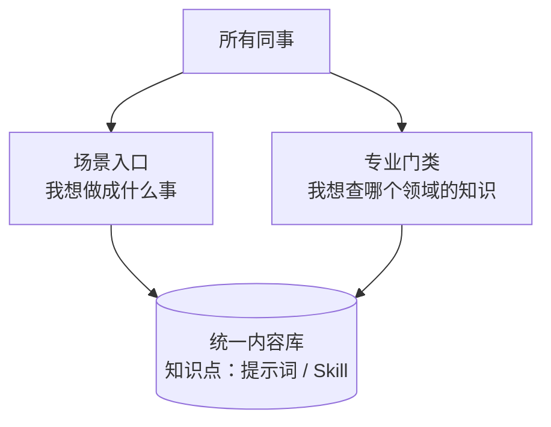

# AI 字典 · 门类规划

> 版本：v0.2（决策确认稿）
> 日期：2026-11-27
> 状态：核心方向已确认，后续进入详细规划

---

## 目录

1. [背景与目标](#一背景与目标)
2. [定位与边界](#二定位与边界)
3. [现有站点诊断](#三现有站点诊断)
4. [总体架构](#四总体架构)
5. [门类总览](#五门类总览)
6. [研发技术类门类](#六研发技术类门类)
7. [产品设计类门类](#七产品设计类门类)
8. [职能类门类](#八职能类门类)
9. [业务类门类](#九业务类门类)
10. [通用类门类](#十通用类门类)
11. [场景入口与门类映射](#十一场景入口与门类映射)
12. [内容单元规范](#十二内容单元规范)
13. [内容生产与治理](#十三内容生产与治理)
14. [规模估算与建设范围](#十四规模估算与建设范围)
15. [已确认决策](#十五已确认决策)

---

## 一、背景与目标

### 1.1 背景

- 未来公司各岗位都会借助 AI 完成工作，包括非研发岗位借助 AI 开发自己的小工具。
- 各岗位之间、同岗位不同人之间，**AI 使用水平差距很大**：会用的人效率成倍提升，不会用的人不知道 AI 能帮自己做什么。
- 公司已有大量隐性知识（设计规范、编码规范、性能标准、财务制度、合同审查要点等），分散在个人经验和各类文档中，**AI 无法直接使用**。

### 1.2 目标

建设一个面向全公司的知识平台，实现三件事：

1. **拉齐信息差**：任何人都能查到公司各领域的专业知识和 AI 用法。
2. **知识可被 AI 直接使用**：知识不以给人看的长文档形式存在，而以提示词和 Skill 的形式提供，复制或安装即可让 AI 按公司标准工作。
3. **助力 AI 转型**：信息拉齐后，任何人都可以借助 AI 跨岗位完成复杂工作，适应扁平化、一人多能的工作方式。

---

## 二、定位与边界

### 2.1 一句话定位

> **AI 时代的跨岗位知识字典**：把公司各岗位做事所需的知识，变成 AI 能直接使用的提示词和 Skill。人人看到同一套内容，查到就能用。

“字典”的含义：按门类和知识域查找所需知识，快速获得现成的 AI 用法和公司标准，并直接交给 AI 使用。

### 2.2 已确认的原则

| 原则 | 说明 |
|---|---|
| 人人平等 | 不按身份划分入口，所有人看到同一套内容。财务同学可以进入后端门类学习接口规范，开发同学也可以进入财务门类了解预算知识 |
| 只输出提示词和 Skill | 平台不做开发平台、不做低代码、不做作品展示。规范类知识以 Skill 或 Rules 形式提供 |
| 内容由项目团队生产 | 由项目团队统一产出，其他同事不投稿，只提意见和需求 |
| 内容托管在平台 | 提示词、Skill、规范文件存放在平台上，可直接复制和下载，不依赖外部链接 |
| 不分等级 | 内容不按经验或职级划分等级，所有人使用同一套提示词和 Skill。不同熟悉程度的需求由快捷版、标准版、Skill 三种形态和生成、审查、讲解三种用法满足 |
| 全量规划与开发 | 22 个门类、157 个知识域及本文档列出的知识点一次规划、全量开发，不采用少量知识点试点上线 |
| 不做人员交互 | 不提供“找人”、联系人、负责人或门类对接人等能力，平台只承载知识与使用反馈 |

### 2.3 不做什么

- 不做在线开发、在线运行、应用发布。
- 不做员工作品展示区。
- 不做开放编辑的 Wiki。
- 不做联系人目录、专家黄页或人员对接。
- 不托管与 AI 使用无关的普通文档（如纯制度原文、会议记录）。

---

## 三、现有站点诊断

现有站点「界面素材库」（`https://qq.ui.gallery.com/`）作为平台的起点。平台新建工程开发，现有站点的素材、设计令牌、交互演示和提示词全部迁移过来，归入 **UI/UX 设计门类**。

### 3.1 现状

| 项目 | 内容 |
|---|---|
| 内容规模 | 445 个素材：界面组件 200、网站动画 200、网站风格 24、B 端登录页 21 |
| 每个素材包含 | 可交互演示、深浅色主题、可复制代码、中文 AI 提示词 |
| 使用方式 | 复制提示词后粘贴到 Cursor、Claude Code、通义等工具，按编号或描述生成到项目中 |
| 设计令牌 | 统一使用 `--ux-*` 令牌，接入项目主题变量即可 |

### 3.2 值得沿用到全站的设计

- **“看效果 → 复制提示词 → 交给 AI”** 的使用链路，所有门类都应沿用。
- **按编号引用**（如“把 056 号组件接到页面”），扩展为全站统一编号体系。
- **统一设计令牌**，作为平台自身和设计门类的规范基础。

### 3.3 扩展前需要解决的问题

| 问题 | 影响 | 建议 |
|---|---|---|
| 整站是单个 4.9 MB 的 HTML，内容内嵌在脚本中 | 增加门类后加载和维护都不可持续 | 内容数据与页面模板分离 |
| 数据中有 29 个细分类，前台只露出 4 个标签 | 200 个组件堆在一起，查找困难 | 在设计门类下露出完整分类 |
| 内部分类名和 CSS 注释残留韩文 | 内部平台不规范 | 统一清理为中文 |
| canonical 和分享图指向外部域名 `ui-gallery.pages.dev` | 内部平台指向外部站点 | 改为内部域名 |

---

## 四、总体架构

### 4.1 两条入口，一套内容

| 入口 | 作用 | 组织方式 |
|---|---|---|
| 专业门类（主轴） | 承载又深又通用的专业知识，是平台的知识库本体 | 门类 → 知识域 → 知识点 |
| 场景入口（快捷入口） | 让不熟悉专业划分的同事快速找到用法 | 做设计、做软件、写文档、分析数据、做调研、公司规范 |

场景入口**不产生新内容**，只引用门类中的知识点。

### 4.1.1 三种内容形态

每个知识点按使用深度提供不同形态，由使用者自行选择，不划分等级：

| 形态 | 说明 |
|---|---|
| 快捷版 | 一两句话的提示词，复制即用 |
| 标准版 | 结构完整的提示词，包含输入、约束、输出格式、缺失追问和自检 |
| Skill | 安装到 AI 工具后自动生效，适合高频使用 |

### 4.2 三级知识结构

| 层级 | 含义 | 示例 |
|---|---|---|
| 门类 | 一个专业学科 | 后端工程 |
| 知识域 | 门类下的一个知识方向 | 设计模式应用 |
| 知识点 | 一个可直接使用的最小知识单元，对应一条提示词或 Skill | 用策略模式实现多支付渠道 |

### 4.3 一个知识点，三种用法

| 用法 | 目的 | 交付形式 | 主要使用者 |
|---|---|---|---|
| 生成 | 让 AI 按规范产出内容 | Skill / Rules，安装后自动生效 | 本领域从业者、跨领域做事的同事 |
| 审查 | 让 AI 按规范检查已有成果 | 审查提示词，输出问题清单 | 本领域从业者、评审人 |
| 讲解 | 让非本领域的人看懂这个知识 | 讲解提示词，附正反示例 | 跨岗位学习者 |

不是每个知识点都需要三种用法，但每个知识点**至少提供一种**。

### 4.4 知识属性：通用与定标

| 属性 | 含义 | 示例 | 生产方式 |
|---|---|---|---|
| 行业通用 | 业界有共识，无需公司特别规定 | 设计模式、SQL 注入防护、三大报表解读 | 项目团队直接编写 |
| 需公司定标 ★ | 需要形成统一标准和具体数值 | 接口 P99 响应时间、编码规范细则、数据分级、报销标准 | 项目团队直接制定默认标准并写成 Skill，发布后根据异议和反馈调整 |

本文档中标注 ★ 的知识点为**需公司定标**。

### 4.5 标签体系

| 标签组 | 取值 |
|---|---|
| 内容类型 | 提示词 / Skill / Rules |
| 用法 | 生成 / 审查 / 讲解 |
| 知识属性 | 行业通用 / 公司定标 |
| 使用环境 | 任意 AI 对话工具 / AI 编程工具（能读写项目文件）/ 支持 Skill 的工具。按工具能力划分，不按模型或厂商划分 |
| 技术栈（仅研发类） | Java / Go / Python / Node.js / TypeScript / Swift / Kotlin 等 |

---

## 五、门类总览

共 **5 大类、22 个门类**。

| 大类 | 编码 | 门类 | 知识域数 |
|---|---|---|---|
| 研发技术 | BE | 后端工程 | 14 |
| 研发技术 | FE | 前端工程 | 10 |
| 研发技术 | MO | 移动端与客户端 | 7 |
| 研发技术 | QA | 测试与质量 | 7 |
| 研发技术 | OPS | 运维与 SRE | 9 |
| 研发技术 | DATA | 数据与 BI | 8 |
| 研发技术 | AIE | AI 应用工程 | 8 |
| 研发技术 | ARCH | 架构与技术管理 | 6 |
| 研发技术 | SEC | 信息安全 | 6 |
| 产品设计 | PD | 产品 | 7 |
| 产品设计 | UX | UI/UX 设计 | 10 |
| 职能 | FIN | 财务 | 8 |
| 职能 | HR | 人力资源 | 7 |
| 职能 | LEG | 法务与合规 | 6 |
| 职能 | ADM | 行政与采购 | 4 |
| 业务 | MKT | 市场与品牌 | 5 |
| 业务 | SAL | 销售与商务 | 5 |
| 业务 | OPR | 运营 | 5 |
| 业务 | CS | 客户服务 | 4 |
| 通用 | MGT | 管理与项目协作 | 6 |
| 通用 | GEN | AI 通用能力 | 6 |
| 通用 | EXP | 表达与呈现 | 9 |
| **合计** | | **22 个门类** | **157 个知识域** |

---

## 六、研发技术类门类

### 6.1 后端工程（BE）

| 知识域 | 知识点 |
|---|---|
| 编码规范 | 命名规范 ★、包结构与分层（controller / service / repository / domain）★、异常体系与错误码 ★、日志规范（级别、格式、脱敏、链路 ID）★、注释规范、代码格式化配置 ★、魔法值与常量管理、空值处理 |
| 接口设计规范 | RESTful 风格、统一返回体 ★、错误码映射 ★、分页与排序、接口版本管理、幂等设计、参数校验、批量接口、文件上传下载、OpenAPI 文档生成、接口变更与兼容性 |
| 数据库规范 | 建表规范（主键、必备字段、字符集）★、索引设计原则、SQL 编写禁忌 ★、事务使用规范、逻辑删除、分库分表策略、DDL 变更与数据迁移流程 ★、大表治理、数据归档 |
| 通用工具类标准 | 工具库选型与禁用清单 ★（Hutool、Guava、Apache Commons 等）、日期时间处理、JSON 序列化 ★、HTTP 客户端 ★、对象拷贝、加解密工具、ID 生成器 ★、金额计算规范、字符串与集合处理 |
| 公共组件与插件标准 | 统一鉴权 ★、分布式锁、幂等组件、限流组件、缓存组件、操作日志、数据权限 ★、多租户插件 ★、导入导出组件、ORM 插件使用规范（MyBatis 等）★、定时任务框架 ★、文件存储组件 ★ |
| 中间件使用规范 | Redis（key 命名 ★、过期策略、大 key 与热 key、数据结构选型）、消息队列（消息幂等、顺序消费、重试与死信、消息积压处理）、Elasticsearch（索引与映射设计、查询优化）、配置中心 ★、注册中心、对象存储 |
| 性能标准 | 接口响应时间分级（P95 / P99）★、单机吞吐基线 ★、SQL 执行时间阈值 ★、慢查询标准 ★、缓存命中率基线 ★、连接池配置 ★、线程池配置 ★、JVM 内存与 GC 停顿基线 ★、压测规范与报告模板 ★、性能问题排查方法 |
| 设计模式应用 | 策略模式（多支付渠道）、模板方法（导入导出流程）、责任链（风控校验、审批流）、状态模式（订单状态机）、观察者与事件驱动（业务解耦）、工厂模式（多类型对象创建）、建造者模式（复杂对象构建）、适配器模式（第三方对接）、装饰器模式（功能增强）、代理模式（AOP、远程调用）、单例模式（正确实现与陷阱）、门面模式（子系统封装） |
| 架构模式 | 分层架构、六边形架构、DDD 领域建模（聚合、实体、值对象、领域事件）、CQRS、事件溯源、Saga 分布式事务、Outbox 可靠消息、熔断降级、读写分离、缓存一致性方案 |
| 分布式与高可用 | 分布式事务选型、分布式 ID、服务拆分原则、服务间调用规范 ★、服务治理、灰度发布、容灾与多活、限流降级策略 ★ |
| 并发编程 | 线程安全、锁的选择、并发容器、异步编程、CompletableFuture 与协程、常见并发陷阱 |
| 可观测性 | 日志规范 ★、指标埋点规范 ★、链路追踪接入 ★、告警分级 ★、监控大盘模板 |
| 安全编码 | SQL 注入防护、XSS 防护、越权校验、敏感数据加密与脱敏 ★、密钥管理 ★、依赖漏洞处理、接口防刷 |
| 技术栈专项 | Java / Spring Boot 最佳实践、Go 最佳实践、Python 最佳实践、Node.js 最佳实践、各技术栈常见坑与升级指南 |

### 6.2 前端工程（FE）

| 知识域 | 知识点 |
|---|---|
| 编码规范 | 目录结构 ★、组件与文件命名 ★、TypeScript 类型规范、ESLint 与 Prettier 配置 ★、样式方案选型 ★（CSS Modules、Tailwind 等）、注释与文档 |
| 组件设计 | 组件拆分原则、受控与非受控组件、组件 API 设计、基础组件与业务组件分层、组件文档与示例、组件库使用规范 ★ |
| 状态与数据 | 状态管理选型 ★、请求层封装 ★、接口错误处理、数据缓存策略、表单方案、数据校验 |
| 工程化 | 构建工具配置、包管理规范 ★、Monorepo、环境变量管理、发布与回滚流程 ★、依赖升级策略 |
| 性能标准 | 首屏时间基线 ★、Core Web Vitals 基线（LCP、INP、CLS）★、包体积预算 ★、图片规范、懒加载与代码分割、性能分析方法 |
| 设计模式应用 | 组合模式、Hooks 复用、高阶组件、发布订阅、依赖注入、微前端架构 |
| 兼容与适配 | 浏览器兼容范围 ★、移动端适配、深浅色主题、国际化 |
| 体验实现规范 | 加载、空、错误三态，骨架屏，交互反馈时长 ★，动效实现，无障碍实现 |
| 前端安全 | XSS 防护、CSP 配置、Token 存储、敏感信息不进前端、第三方脚本管理 |
| 框架专项 | React 最佳实践、Vue 最佳实践、小程序开发规范、Node 服务端渲染 |

### 6.3 移动端与客户端（MO）

| 知识域 | 知识点 |
|---|---|
| 编码规范 | iOS（Swift）规范 ★、Android（Kotlin）规范 ★、跨端框架规范（Flutter、React Native）★ |
| 架构设计 | MVVM / MVI 架构、模块化与组件化、路由设计 |
| 性能标准 | 启动耗时基线 ★、页面流畅度基线 ★、内存与耗电基线 ★、包体积基线 ★ |
| 稳定性 | 崩溃监控、ANR 治理、线上问题排查 |
| 发布规范 | 版本号规范 ★、应用商店审核要点、灰度与热更新 |
| 适配 | 机型与系统适配、屏幕适配、权限申请规范 |
| 桌面客户端 | Electron 开发规范、桌面端安全与更新机制 |

### 6.4 测试与质量（QA）

| 知识域 | 知识点 |
|---|---|
| 测试策略 | 测试金字塔、测试准入准出标准 ★、测试计划模板 ★、风险驱动测试 |
| 用例设计 | 等价类、边界值、场景法、状态迁移法、正交实验、AI 生成用例的审查方法 |
| 自动化测试 | 单元测试规范（Mock、覆盖率要求 ★）、接口自动化、UI 自动化、契约测试、测试数据管理 |
| 专项测试 | 性能测试、安全测试、兼容性测试、稳定性测试、数据迁移测试 |
| 缺陷管理 | 缺陷分级标准 ★、缺陷报告模板 ★、缺陷根因分析 |
| Code Review | Review 清单 ★、关注重点分级、评论规范、AI 辅助 Review |
| 质量度量 | 质量指标体系 ★、线上缺陷逃逸分析、质量报告模板 |

### 6.5 运维与 SRE（OPS）

| 知识域 | 知识点 |
|---|---|
| 容器与编排 | Dockerfile 规范（多阶段构建、镜像瘦身、非 root 运行）★、K8s 资源配置（requests / limits、探针、HPA）★、Helm Chart 规范、命名空间与标签规范 ★ |
| CI/CD | 流水线规范 ★、分支与发布策略 ★、制品管理、回滚机制、发布窗口 ★ |
| 网关与网络 | Nginx 配置规范、Ingress 规则 ★、域名与证书管理 ★、负载均衡、DNS 管理 |
| 稳定性标准 | SLA / SLO 定义 ★、容量规划、变更管理规范 ★、值班制度 ★ |
| 监控告警 | 监控覆盖标准 ★、告警分级与通知策略 ★、Prometheus 与 Grafana 使用规范 |
| 故障处理 | 应急响应流程 ★、故障分级 ★、复盘模板 ★、常用排障命令手册 |
| 成本治理 | 资源盘点、资源利用率基线 ★、降本方案模板 |
| 基础设施即代码 | Terraform 规范、Ansible 规范、配置漂移检测 |
| 主机与系统 | Linux 系统管理、内核参数调优、日志轮转、备份与恢复 ★ |

### 6.6 数据与 BI（DATA）

| 知识域 | 知识点 |
|---|---|
| 数仓规范 | 分层规范（ODS / DWD / DWS / ADS）★、表命名规范 ★、字段命名规范 ★、分区规范 ★ |
| 数据建模 | 维度建模、宽表设计、拉链表、主题域划分 |
| 指标体系 | 指标定义规范 ★、口径管理 ★、指标字典 ★ |
| SQL 与计算 | 查询性能规范、常用分析 SQL 模板、Spark / Flink 任务规范 |
| 数据质量 | 校验规则 ★、质量监控告警、数据血缘 |
| 可视化 | 图表选型规范、看板设计规范 ★、报表命名规范 ★ |
| 数据治理 | 数据分级 ★、权限申请流程 ★、敏感数据使用规范 ★、元数据管理 |
| 数据分析方法 | 漏斗分析、留存分析、归因分析、AB 实验分析 |

### 6.7 AI 应用工程（AIE）

| 知识域 | 知识点 |
|---|---|
| 提示词工程 | 系统提示词设计、结构化输出、少样本示例、思维链、提示词版本管理 |
| RAG 与知识库 | 文档切分、向量化与检索、召回优化、知识库更新机制 |
| Agent 开发 | Agent 架构、工具调用、记忆管理、多 Agent 协作、上下文工程 |
| Skill 与 MCP | Skill 编写规范 ★、MCP Server 开发、工具接入规范 ★ |
| 模型选型与调用 | 模型能力对比、成本与延迟权衡、公司可用模型清单 ★、调用规范与限流 ★ |
| AI 评测 | 评测集构建、自动评测方法、线上效果监控 |
| AI 安全 | 提示词注入防护、输出内容审核、数据外发规范 ★ |
| AI 编程规范 | AI 辅助编码流程 ★、项目 Rules 模板 ★、AI 生成代码的审查要求 ★ |

### 6.8 架构与技术管理（ARCH）

| 知识域 | 知识点 |
|---|---|
| 技术方案 | 方案文档模板 ★、RFC 流程 ★、技术评审清单 ★ |
| 技术选型 | 选型评估框架、开源组件引入规范 ★、License 合规检查 |
| 架构治理 | 架构决策记录（ADR）★、技术债管理、系统依赖梳理、架构图规范 ★ |
| 系统设计 | 高并发设计、高可用设计、可扩展设计、多租户设计、系统设计案例库 |
| 研发流程 | 需求到上线流程 ★、迭代节奏、研发效能指标 ★ |
| 技术规划 | 技术路线图、技术栈统一、平台化建设 |

### 6.9 信息安全（SEC）

| 知识域 | 知识点 |
|---|---|
| AI 使用安全 | 数据分级 ★、外部模型使用红线 ★、脱敏方法、AI 工具准入清单 ★ |
| 应用安全 | OWASP Top 10、安全编码清单 ★、渗透测试方法、漏洞分级与修复时限 ★ |
| 数据安全 | 加密规范 ★、脱敏规范 ★、备份规范 ★、数据出境规范 ★ |
| 身份与访问 | 账号权限管理 ★、最小权限原则、密钥与凭证管理 ★ |
| 安全运营 | 安全事件响应 ★、日志审计、安全意识培训 |
| 合规 | 等保要求落地、个人信息保护法落地、行业合规要求 |

---

## 七、产品设计类门类

### 7.1 产品（PD）

| 知识域 | 知识点 |
|---|---|
| 需求分析 | 用户访谈提纲、需求池管理、优先级模型（RICE、KANO、MoSCoW）、用户故事写法、需求评审清单 ★ |
| 文档规范 | PRD 模板 ★、需求变更规范 ★、验收标准写法、版本说明模板 |
| 产品设计 | 信息架构、业务流程图、原型描述、交互说明、状态与异常梳理 |
| 数据驱动 | 北极星指标、埋点设计规范 ★、AB 实验设计、数据分析报告 |
| 商业分析 | 竞品分析框架、商业模式画布、定价策略、市场规模估算 |
| B 端产品 | 权限体系设计、配置化设计、审批流设计、多租户产品设计 |
| AI 产品 | AI 功能设计方法、AI 体验设计、AI 产品评估指标 |

### 7.2 UI/UX 设计（UX）

现有「界面素材库」445 个素材全部归入本门类。

| 知识域 | 知识点 |
|---|---|
| 设计系统 | 设计令牌 ★、栅格与间距 ★、字体层级 ★、色彩体系 ★、圆角与阴影 ★、图标规范 ★、深浅色主题 |
| 界面组件 | 按钮、开关与选择、表单输入、输入与搜索、菜单与标签页、导航、卡片与内容、通知与反馈、加载与进度、空状态与错误状态、登录与注册（来源：现有素材库） |
| 数据与业务组件 | 图表与小部件、数据动效、电商与价格、营销与奖励、社交证明、文档与数据编辑、空间日程与设计工具、构建工具、工作与系统界面（来源：现有素材库） |
| 页面模式 | 登录页（现有 21 个）、落地页、后台工作台、列表页、详情页、设置页、空状态页、错误页 |
| 网站风格 | 现有 24 套整站风格，按行业和调性筛选 |
| 动效规范 | 时长与缓动曲线标准 ★、文字动效、滚动动效、首屏与背景、光标与悬停（来源：现有素材库） |
| 视觉素材生成 | icon 生成、插画生成、海报与 Banner、PPT 视觉、配色方案生成 |
| 品牌视觉 | 品牌色 ★、品牌字体 ★、Logo 使用规范 ★、品牌 icon 资产 ★ |
| 体验标准 | 可用性原则、无障碍标准 ★、设计走查清单 ★、用户研究方法 |
| 设计交付 | 标注规范 ★、切图规范 ★、设计稿转代码、设计与开发协作流程 ★ |

---

## 八、职能类门类

### 8.1 财务（FIN）

| 知识域 | 知识点 |
|---|---|
| 会计核算 | 会计科目使用规范 ★、凭证审核要点 ★、月结流程清单 ★、收入确认规则 |
| 报表分析 | 三大报表解读、经营分析报告模板 ★、同比环比分析、杜邦分析 |
| 预算管理 | 预算编制模板 ★、预算执行分析、滚动预测、预算调整流程 ★ |
| 成本管控 | 成本归集与分摊 ★、云资源成本分析、人力成本分析、降本方案模板 |
| 税务 | 发票合规校验 ★、增值税与所得税常见问题、税务政策解读 |
| 资金与费控 | 报销制度问答 ★、付款审核要点 ★、资金计划、费用标准 ★ |
| 财务工具 | Excel 财务函数、财务模型搭建、数据透视分析 |
| 审计与内控 | 内控检查清单 ★、审计配合要点、风险识别 |

### 8.2 人力资源（HR）

| 知识域 | 知识点 |
|---|---|
| 招聘 | JD 撰写、简历筛选标准 ★、结构化面试题库（按岗位）★、面试评估表 ★、录用通知模板 ★ |
| 培训发展 | 培训需求分析、课程大纲设计、新人入职培训 ★、AI 技能培训体系 ★ |
| 绩效管理 | OKR 制定、KPI 制定、绩效面谈话术、绩效评估标准 ★ |
| 薪酬福利 | 薪酬结构设计、调薪方案、福利制度问答 ★ |
| 员工关系 | 劳动法常见问题、入离职流程 ★、员工沟通模板、员工关怀方案 |
| 组织发展 | 岗位说明书模板 ★、能力模型 ★、职级体系 ★、组织诊断 |
| 雇主品牌 | 招聘文案、校园招聘方案、员工故事 |

### 8.3 法务与合规（LEG）

| 知识域 | 知识点 |
|---|---|
| 合同管理 | 合同审查清单（采购、销售、劳动、保密、技术服务等）★、风险条款识别、合同模板 ★、合同审批流程 ★ |
| 知识产权 | 商标、专利、软件著作权、开源 License 合规 ★ |
| 数据合规 | 隐私政策 ★、个人信息处理规范 ★、用户协议 ★、数据处理协议 |
| 劳动法务 | 劳动合同要点、竞业限制、劳动纠纷处理 |
| 公司治理 | 内控制度 ★、反舞弊 ★、合规培训材料 |
| 争议解决 | 律师函写法、诉讼与仲裁流程、证据保全 |

### 8.4 行政与采购（ADM）

| 知识域 | 知识点 |
|---|---|
| 行政事务 | 会议与活动组织清单、办公资产管理 ★、差旅规范 ★、通知公告模板 |
| 采购管理 | 供应商评估标准 ★、比价分析、采购合同要点、招投标流程 ★ |
| 公文写作 | 公文格式 ★、请示与报告写法、会议通知 |
| 场地与后勤 | 办公场地管理、安全与消防规范、应急预案 ★ |

---

## 九、业务类门类

### 9.1 市场与品牌（MKT）

| 知识域 | 知识点 |
|---|---|
| 品牌管理 | 品牌调性规范 ★、品牌用语规范 ★、品牌视觉应用（与 UX 门类联动） |
| 内容营销 | 文案写作框架（AIDA、FAB 等）、公众号文章、短视频脚本、SEO 优化 |
| 活动策划 | 活动方案模板、活动预算、活动复盘 |
| 市场分析 | 市场调研框架、用户画像、竞品监测 |
| 公关传播 | 新闻稿写法、危机公关预案 ★、媒体沟通 |

### 9.2 销售与商务（SAL）

| 知识域 | 知识点 |
|---|---|
| 销售方法 | 客户需求挖掘、方案讲解话术、异议处理、销售流程 ★ |
| 售前材料 | 解决方案模板 ★、投标文件编写、产品对比材料、客户案例 |
| 客户管理 | 客户分级标准 ★、跟进记录规范、商机分析 |
| 商务谈判 | 报价策略 ★、合同谈判要点、折扣审批规则 ★ |
| 渠道合作 | 合作伙伴评估、渠道政策 ★、联合方案 |

### 9.3 运营（OPR）

| 知识域 | 知识点 |
|---|---|
| 用户运营 | 用户分层、生命周期运营、召回策略、社群运营 |
| 内容运营 | 选题策划、内容日历、内容审核规范 ★、内容数据复盘 |
| 活动运营 | 活动设计、转化漏斗分析、活动风控 |
| 数据运营 | 运营指标体系 ★、周报月报模板 |
| 增长 | 增长模型、裂变设计、渠道投放分析 |

### 9.4 客户服务（CS）

| 知识域 | 知识点 |
|---|---|
| 服务规范 | 服务话术 ★、投诉处理流程 ★、情绪安抚、服务承诺 ★ |
| 知识库建设 | FAQ 整理、问题分类体系、工单模板 ★ |
| 服务质量 | 服务质检标准 ★、满意度分析、服务报告 |
| 技术支持 | 问题定位引导、故障通报模板 ★、升级流程 ★ |

---

## 十、通用类门类

### 10.1 管理与项目协作（MGT）

| 知识域 | 知识点 |
|---|---|
| 团队管理 | 一对一沟通、团队目标拆解、授权与反馈、团队建设 |
| 决策分析 | 决策框架、风险评估、复盘方法（KPT、AAR）、问题分析（5W2H、鱼骨图） |
| 汇报沟通 | 向上汇报结构、金字塔原理、数据化表达、汇报 PPT |
| 项目管理 | 项目计划模板 ★、WBS 拆解、风险管理、进度汇报模板 ★、敏捷实践 |
| 跨部门协作 | 协作流程 ★、会议规范 ★、RACI 责任矩阵 |
| 战略规划 | 年度规划模板、SWOT 分析、OKR 对齐 |

### 10.2 AI 通用能力（GEN）

所有人使用 AI 的基础门类。

| 知识域 | 知识点 |
|---|---|
| 提示词基础 | 提示词结构、如何提供上下文、让 AI 追问、迭代优化、角色与约束设定 |
| AI 工具入门 | 公司可用 AI 工具清单 ★、AI 对话工具入门、AI 编程工具入门、Skill 安装与使用、Rules 配置方法 |
| 通用办公 | 写作与润色、总结与提炼、翻译、Excel 公式、PPT 生成、会议纪要、邮件 |
| AI 使用红线 | 与信息安全门类联动，所有人必读 ★ |
| 判断 AI 输出 | 识别幻觉、事实核查、什么情况下不能用 AI |
| 用 AI 做小工具 | 如何向 AI 描述需求、从零做一个小脚本、常见问题处理（与后端、前端门类联动） |

### 10.3 表达与呈现（EXP）

所有岗位都要用、专业门槛又高的表达能力：写文档、做 PPT、画图、做图表。PPT 类提示词按“故事线 → 逐页设计 → 生成成品”三步拆分，不提供一句话生成整份 PPT 的提示词。

| 知识域 | 知识点 |
|---|---|
| 写作原则 | 结论先行、金字塔结构、SCQA 开场、简明表达、面向读者写作、段落与过渡 |
| 中文排版 | 中英文混排空格、标点使用、数字与单位、术语统一、列表与表格规范 |
| 文档类型规范 | 技术文档四类型（教程、操作指南、参考、原理说明）、方案、报告、制度、会议纪要、公文格式、公司文档模板 ★ |
| PPT 结构 | 故事线设计、标题即结论、一页一个观点、草稿目录、汇报型与培训型与路演型 PPT 的结构差异 |
| PPT 视觉 | 版式网格、字号层级、配色规则、留白、图片与图标使用、公司 PPT 模板 ★ |
| 数据可视化 | 图表选型、数据墨水比、坐标轴规范、颜色语义、避免误导性图表、数据表格设计 |
| 技术绘图 | 架构图（C4 模型）、时序图、类图、状态图、ER 图、部署图、云架构图、架构图规范（与 ARCH 门类联动）★ |
| 业务绘图 | 业务流程图（BPMN）、泳道图、组织架构图、思维导图、用户旅程图、价值流图 |
| 绘图工具 | Mermaid、PlantUML、draw.io、Excalidraw 的语法与生成提示词，图表导出与嵌入规范 |

---

## 十一、场景入口与门类映射

场景入口是首页的快捷入口，内容全部引用自门类。

| 场景入口 | 包含的内容 | 主要来源门类 |
|---|---|---|
| 做设计 | 网站风格、页面、组件、动效、视觉素材、设计转代码、PPT 视觉、绘图 | UX、FE、MKT、EXP |
| 做软件 | 需求、方案、编码、测试、部署、排查问题、架构图 | PD、BE、FE、MO、QA、OPS、ARCH、AIE、GEN、EXP |
| 写文档 | 沟通、汇报、会议、方案制度、对外内容、翻译、PPT | EXP、GEN、MGT、PD、ADM、MKT |
| 分析数据 | 表格处理、取数查询、解读可视化、测算建模、图表制作 | DATA、FIN、OPR、GEN、EXP |
| 做调研 | 资料检索、竞品分析、长文档阅读 | PD、MKT、LEG、GEN |
| 公司规范 | 所有标注 ★ 的定标类知识点 | 全部门类 |

---

## 十二、内容单元规范

### 12.1 编号规则

格式：`门类编码-三位序号`，例如：

| 编号 | 含义 |
|---|---|
| `UX-056` | UI/UX 设计门类第 56 号知识点（现有素材库编号平移） |
| `BE-012` | 后端工程门类第 12 号知识点 |
| `FIN-008` | 财务门类第 8 号知识点 |

编号一经发布不再变更，可以直接对 AI 说“按 `BE-012` 的规范实现”。

### 12.2 字段

| 字段 | 必填 | 说明 |
|---|---|---|
| 编号 | 是 | 见 12.1 |
| 标题 | 是 | 一句话说清楚这是什么 |
| 用途 | 是 | 解决什么问题、适用什么场景 |
| 所属位置 | 是 | 门类 / 知识域 |
| 用法 | 是 | 生成 / 审查 / 讲解，可多选 |
| 内容主体 | 是 | 提示词文本，或 Skill / Rules 文件 |
| 效果展示 | 是 | 设计类为可交互演示；其他为“输入示例 → 输出效果”对比 |
| 使用说明 | 是 | 需要提供哪些信息、使用步骤、常见坑 |
| 内容形态 | 是 | 快捷版 / 标准版 / Skill，至少提供一种 |
| 标签 | 是 | 内容类型、知识属性、使用环境、技术栈 |
| 关联知识点 | 否 | 前置知识、相关知识 |
| 版本与更新时间 | 是 | 规范更新后需同步更新 |

---

## 十三、内容生产与治理

### 13.1 角色

| 角色 | 职责 |
|---|---|
| 项目团队 | 唯一的内容生产方，负责编写、审核、发布、维护全部内容，并直接确定定标类知识点的默认标准 |
| 全体同事 | 使用内容，提出意见和需求 |

### 13.2 定标类知识点生产流程

### 13.3 意见收集闭环

- 提供“需求与反馈”入口，所有人可提交需求和对已有内容的意见。
- 每条需求公开状态：已收录、制作中、已上线、不予收录（附原因）。
- 每条内容有“好用 / 不好用”反馈，项目团队定期根据反馈和使用数据迭代。

### 13.4 内容维护

- 规范变更时，对应 Skill 必须同步更新，并在详情页记录版本变化。
- 定期检查内容是否适配最新的 AI 工具和模型。
- 长期无人使用且无反馈的内容进入复审。

---

## 十四、规模估算与建设范围

### 14.1 规模估算

| 项目 | 数量 |
|---|---|
| 门类 | 22 |
| 知识域 | 157 |
| 知识点（本文档列出） | 约 740 |
| 其中需公司定标（★） | 约 215 |
| 现有素材（UX 门类） | 445 |

### 14.2 建设范围

| 范围 | 目标 | 主要工作 |
|---|---|---|
| 新建工程并迁移现有素材 | 搭建能够承载完整 AI 字典的工程 | 基于 Nuxt 4 新建工程，内容数据与页面模板分离；落地统一编号和内容单元格式；将现有素材归入 UX 门类并露出完整分类；清理韩文残留和外部域名；建设全局搜索 |
| 门类与内容全量建设 | 首轮交付即具备完整知识体系 | 一次完成 22 个门类、157 个知识域及本文档列出的约 740 个知识点，不设置仅含 1–2 个代表性知识点的试点阶段 |
| 定标内容同步建设 | 发布时即可按统一标准使用 | 由项目团队为约 215 个定标类知识点制定默认标准，形成提示词、Skill 或 Rules，发布后根据反馈持续修订 |
| 使用入口完整建设 | 让用户能够按不同方式发现同一套内容 | 同步建设专业门类、场景入口、全局搜索、复制与下载等核心能力 |
| 后续增强 | 让内容进一步融入工作流 | 在首轮全量交付后，根据详细规划评估 MCP 或 Skill 仓库等增强能力 |

---

## 十五、已确认决策

| 序号 | 事项 | 确认结果 |
|---|---|---|
| 1 | 是否加入“找人”维度 | 不加入，不提供联系人、负责人或人员对接能力 |
| 2 | 现有站点的演进方式 | 新建工程，迁移现有素材、设计令牌、交互演示和提示词，归入 UI/UX 设计门类。现有站点为原生 HTML 单文件，不沿用其技术 |
| 3 | 首轮内容量 | 一次规划、全量开发本文档列出的全部门类、知识域和知识点 |
| 4 | 门类对接机制 | 不设置门类对接人，不规划人员负责与对接机制 |
| 5 | 定标类标准如何确定 | 由项目团队直接制定并默认生效，未来出现异议时再评估调整 |
| 6 | 平台名称 | AI 字典 |
| 7 | 内容是否分等级 | 不分等级，所有人使用同一套内容，取消学习路径；通过快捷版、标准版、Skill 三种形态满足不同使用深度 |
| 8 | 是否新增表达与呈现门类 | 新增 EXP 门类，覆盖写作、PPT、数据可视化与绘图 |
| 9 | 内容是否按模型或厂商区分 | 不区分。提示词和 Skill 保持通用，只按使用环境（对话工具、编程工具、支持 Skill 的工具）标注 |
| 10 | 用户登录方式 | 通过飞书自建应用（机器人）获取个人信息完成登录，并存储用户信息 |
| 11 | 技术栈 | 前端 Nuxt 4 + Vue 3 + TypeScript；后端 Java + Spring Boot 4。知识内容由 Git 管理并静态生成，后端只负责登录、收藏、反馈、需求墙、统计、通知与管理后台 |
